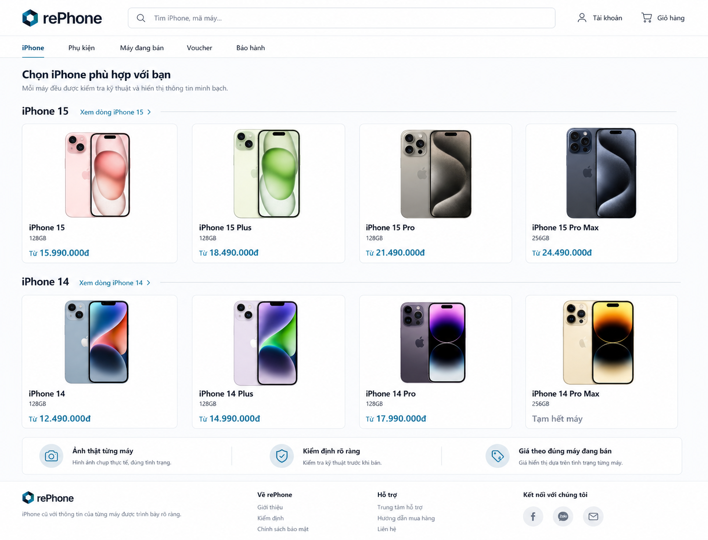

# rePhone Web Design System & UX Contract v1.3

> Trạng thái tài liệu: **APPROVED**  
> Phạm vi: **Post-P0 / P1 frontend refinement**  
> P0 baseline: [plan.md](plan.md)  
> Backend contract: [docs/readme.md](docs/readme.md)  
> Frontend implementation plan: [plan-fe.md](plan-fe.md)  
> Frontend baseline SHA: `801ad26`  
> Ngày cập nhật: `2026-08-26`



> Mockup trên khóa hướng discovery **Retail Catalog Rows**: header gọn, sản phẩm xuất hiện trước, một hàng cho mỗi thế hệ và card model dễ quét. Nó không phải nguồn cho dữ liệu, chính sách hoặc microcopy. Giá, tình trạng máy và model phải đến từ public catalog; các claim minh họa như “36 bước”, “đã gồm VAT”, “2 chi nhánh”, “7 ngày đổi trả”, miễn phí giao hàng hoặc ETA không được đưa vào sản phẩm nếu chưa có contract/settings tương ứng.

Hai mockup sau là canonical presentation reference cho hai route storefront chi tiết:

| Route pattern                            | Reference đã duyệt                                                                                        |
| ---------------------------------------- | --------------------------------------------------------------------------------------------------------- |
| `/products/[slug]`                       | [Model detail canonical reference](docs/assets/ui/rephone-model-detail-canonical-reference.png)           |
| `/products/[slug]/units/[inventoryCode]` | [Exact-unit detail canonical reference](docs/assets/ui/rephone-exact-unit-detail-canonical-reference.png) |

Chúng khóa hierarchy, density, layout, typography, surface, gallery, card và action placement; chúng không thay thế backend contract. Text, giá, tình trạng, thông số, chính sách và số lượng kiểm định trong ảnh chỉ được triển khai khi có nguồn authority tương ứng.

## 1. Mục đích và cách sử dụng

`design.md` là nguồn quy ước cho cách giao diện rePhone được tổ chức, hiển thị và tương tác. Tài liệu dành cho developer, reviewer, người viết nội dung và người kiểm thử frontend.

Tài liệu này quyết định:

- Visual direction, design tokens và responsive behavior.
- Information hierarchy và navigation theo từng surface.
- Component contract, interaction state và accessibility behavior.
- Quy tắc nội dung, hình ảnh, icon và feedback.
- Tiêu chí để một page được xem là conformant với hệ thống thiết kế.

Tài liệu này không quyết định:

- Role hoặc quyền truy cập thực sự.
- Request/response DTO, endpoint, error code hoặc pagination contract.
- State transition, transaction, pricing, reservation hoặc inventory invariant.
- Chính sách bảo hành, hoàn tiền, giao nhận hoặc kiểm định.

Khi triển khai một page:

1. Đọc contract nghiệp vụ liên quan trong `docs`.
2. Đọc page pattern và component contract trong file này.
3. Đọc phase/work package tương ứng trong `plan-fe.md`.
4. Dùng generated API client; không tự tạo transport hoặc DTO song song.
5. Kiểm tra responsive, keyboard, loading, empty, error và conflict trước khi đánh dấu hoàn thành.

Một page conformant phải:

- Chỉ hiển thị claim có nguồn authority.
- Dùng token và component đã định nghĩa thay vì hard-code style mới.
- Hoạt động ở các viewport đã khóa.
- Không phá auth, ownership, guest credential hoặc security transport.
- Có đủ trạng thái ngoài happy path.
- Qua checklist Design QA tại §22.

## 2. Nguồn sự thật và precedence

Thứ tự ưu tiên khi có khác biệt:

1. `docs/requirements`, `docs/architecture`, `docs/data-model`, `docs/api` và `docs/quality` theo [source precedence](docs/readme.md#nguồn-sự-thật-khi-có-trùng-nội-dung).
2. OpenAPI và generated client phải khớp `docs`; nếu lệch, đó là blocker cần sửa đồng bộ.
3. `design.md` quyết định presentation/interaction khi contract không quy định.
4. `plan-fe.md` quyết định thứ tự, trạng thái và evidence triển khai.
5. CSS/component hiện hành là implementation; không tự trở thành contract chỉ vì đã tồn tại.
6. Ba mockup nội bộ đã duyệt trong §25.1 là canonical presentation reference cho đúng surface được ghi; chúng không được override contract ở mục 1–4.
7. Website bên ngoài, mockup lịch sử và reference chưa được duyệt chỉ là inspiration, không phải requirement.

### 2.1 Contract-source map

| Khu vực UI                          | Nguồn authority tối thiểu                                                                                     |
| ----------------------------------- | ------------------------------------------------------------------------------------------------------------- |
| Scope và non-goal                   | [Product vision](docs/requirements/product-vision-and-scope.md)                                               |
| Role, ownership và guest            | [Roles](docs/requirements/roles-and-permissions.md), [auth transport](docs/api/auth-token-transport.md)       |
| Auth và account                     | [Auth/account endpoints](docs/api/auth-and-account-endpoints.md)                                              |
| Catalog và exact unit               | [Public catalog endpoints](docs/api/public-catalog-endpoints.md)                                              |
| Cart và wishlist                    | [Cart/wishlist endpoints](docs/api/cart-and-wishlist-endpoints.md)                                            |
| Voucher                             | [Voucher endpoints](docs/api/voucher-endpoints.md)                                                            |
| Checkout và customer order          | [Checkout/order endpoints](docs/api/checkout-and-customer-order-endpoints.md)                                 |
| Payment proof                       | [Payment proof/review](docs/api/payment-proof-and-review-endpoints.md)                                        |
| Backoffice catalog/inventory        | [Backoffice catalog/inventory](docs/api/backoffice-catalog-inventory-endpoints.md)                            |
| Fulfillment và refund               | [Backoffice order/fulfillment/refund](docs/api/backoffice-order-fulfillment-refund-endpoints.md)              |
| Warranty và after-sales             | [Warranty/after-sales](docs/api/warranty-and-aftersales-endpoints.md)                                         |
| Employee, customer, settings, audit | [System endpoints](docs/api/employee-settings-audit-endpoints.md)                                             |
| Response và error handling          | [Response contract](docs/api/response-contract.md), [error catalog](docs/api/error-catalog.md)                |
| Typed transport                     | [OpenAPI/client](docs/api/openapi-and-client.md)                                                              |
| NFR và test                         | [NFR](docs/requirements/non-functional-requirements.md), [testing strategy](docs/quality/testing-strategy.md) |

## 3. Định vị trải nghiệm

Ba nguyên tắc trung tâm:

1. **Model giúp khám phá.** Product/model card giúp khách thu hẹp dòng máy, dung lượng, màu và mức giá.
2. **Exact unit giúp quyết định.** Khách mua một `InventoryUnit` cụ thể, không mua một cấu hình chung chung.
3. **Inspection giúp tin tưởng.** Ảnh thật, pin, ngoại hình, lịch sử sửa chữa đã biết và checklist là bằng chứng trước quyết định mua.

Giao diện phải tạo cảm giác:

- Minh bạch, chính xác và bình tĩnh.
- Có chuyên môn nhưng không lạnh lùng.
- Có đủ dữ kiện nhưng không giống dashboard kỹ thuật.
- Bằng chứng xuất hiện trước quảng cáo và cross-sell.
- Mỗi bước đều cho người dùng biết chuyện gì đang xảy ra và nên làm gì tiếp theo.

Không định vị rePhone như marketplace. Một sản phẩm không có seller card, seller rating hoặc chính sách khác nhau theo người bán.

## 4. Visual direction — Retail Commerce + Technical Evidence

Hướng đã duyệt là **Retail Catalog Rows** cho discovery, kết hợp hierarchy mua hàng retail rõ ràng và **Technical Evidence** cho model/exact unit. Ba surface dùng chung token, header, footer, panel, action và nhịp typography nhưng giải quyết các nhiệm vụ khác nhau:

- Home/catalog giúp khách nhận diện và chọn model nhanh như một cửa hàng điện thoại Việt Nam quen thuộc.
- Model detail giúp khách hiểu model rồi quét nhanh các máy vật lý đang bán.
- Exact-unit detail giữ nhịp mua hàng quen thuộc nhưng đưa bằng chứng của đúng chiếc máy lên trước cross-sell.
- Customer portal giữ sự rõ ràng của retail; backoffice giữ mật độ vận hành cao.

Đặc trưng chung:

- Light mode duy nhất trong scope hiện tại.
- Nền trắng/xám xanh nhạt, chữ deep ink.
- Cyan/teal dùng tiết chế cho CTA, focus và dữ kiện quan trọng.
- Border mảnh là phương thức phân cấp mặc định; shadow chỉ dùng khi thực sự nổi lớp.
- Typography tự nhiên, giá dễ quét và khoảng trắng vừa phải; không dàn trang như manifesto.
- Không vay mượn sự ồn ào của sale badge, rating, countdown hoặc banner khuyến mãi từ website tham khảo.

### 4.1 Home và catalog — Retail Catalog Rows

- Header gọn, search/account/cart dễ nhận ra; navigation không chiếm phần lớn first viewport.
- Catalog là nội dung chính ngay sau header. Không đặt hero toàn màn hình trước danh sách máy.
- Mỗi thế hệ iPhone là một section ngang riêng, title rõ và card model có hierarchy `ảnh → tên → giá/tình trạng`.
- Desktop hiển thị khoảng bốn card cùng lúc; mobile cuộn ngang từng thế hệ thay vì ép card thành cột dài.
- Card dùng surface sáng, radius/border nhẹ, ít metadata và không lặp badge trang trí.
- Chỉ một trust strip ngắn được phép xuất hiện sau catalog; không lặp các khối giải thích `01–04` hoặc slogan ở nhiều section.

### 4.2 Model detail và exact-unit — canonical retail evidence

[Model detail mockup](docs/assets/ui/rephone-model-detail-canonical-reference.png) và [exact-unit detail mockup](docs/assets/ui/rephone-exact-unit-detail-canonical-reference.png) là canonical reference cho hierarchy và visual language của hai route tương ứng.

- Model detail dùng gallery minh họa, model facts và grid các exact unit đang bán. Model image luôn có nhãn phân biệt với ảnh của máy vật lý.
- Exact-unit detail dùng gallery ảnh thật, purchase rail, product/unit facts, inspection summary gọn và các máy khác cùng dòng khi public contract cung cấp đủ dữ liệu.
- Storefront còn lại kế thừa header/footer gọn, canvas sáng, panel trắng, border/shadow nhẹ, teal action, icon outline, giá dễ quét và khoảng cách của hai mockup.
- Mockup là target về presentation, không phải fixture dữ liệu. Thành phần không có authority phải được bỏ, thay bằng dữ kiện hợp lệ hoặc dùng trạng thái trống phù hợp.
- Storefront chỉ trình bày inspection summary tối đa năm hạng mục để giữ nhịp mua hàng. Checklist đầy đủ, repair note và masked identifier thuộc workflow vận hành/backoffice, không lặp lại thành dossier dài trên trang mua hàng.

- Ảnh exact unit là visual chính của trang mua hàng.
- Layout rộng nhưng có reading width rõ.
- Dữ kiện mua hàng được nhóm thành gallery, metrics, fulfillment, CTA và inspection summary.
- Inspection summary mang cảm giác bằng chứng đáng tin, không mang thẩm mỹ terminal hoặc sci-fi.
- Mỗi page có một primary action rõ ràng.
- Trang exact unit là canonical reference cho các surface cần trình bày evidence, không phải khuôn bắt buộc cho home/catalog.

### 4.3 Backoffice

- Dùng cùng token, typography và status semantics với storefront.
- Chỉ kế thừa visual token, component primitive, focus/feedback semantics và authoritative action hierarchy từ hai mockup canonical.
- Không sao chép gallery mua hàng, purchase card, recommendation rail hoặc grid retail sang queue/detail vận hành.
- Mật độ cao hơn, ưu tiên scan, filter, queue, timeline và action.
- Desktop dùng sidebar + top bar + content fluid.
- Table/list không được biến thành hàng chục card trang trí.
- Detail page ưu tiên summary, status axes, timeline, evidence và authoritative action rail.
- Mobile vẫn phải hoàn tất được critical command, nhưng màn hình staff được tối ưu trước cho `>= 1024px`.

## 5. Content voice và microcopy

### 5.1 Giọng điệu

- Gọi khách hàng là **“bạn”**.
- Câu ngắn, tự nhiên, thân thiện nhưng không suồng sã.
- Dùng từ cụ thể: ảnh, pin, mã máy, tình trạng, phí, thời hạn.
- Nói thẳng giới hạn hoặc rủi ro thay vì che bằng copy marketing.
- Không dùng giọng quảng cáo khoa trương hoặc câu chữ dài, chung chung, lặp cấu trúc như nội dung do AI tạo hàng loạt.
- Không lặp uppercase eyebrow trên mọi section; chỉ dùng label nhỏ khi nó bổ sung ngữ cảnh thật.
- Không dùng số thứ tự `01`, `02`, `03` để trang trí. Chỉ đánh số khi người dùng thực sự phải làm theo một quy trình tuần tự.
- Không viết headline để giải thích điều đã rõ từ tên model, giá và trạng thái card.
- Backoffice dùng động từ nghiệp vụ chính xác, không dùng câu “thành công mỹ mãn” hoặc lời khen không cần thiết.

Ví dụ storefront:

```text
iPhone 15 Pro
Từ {giá thấp nhất hiện hành}

iPhone 15 Plus
Tạm hết máy
```

Ví dụ error:

```text
Chiếc máy này vừa không còn khả dụng.
Bạn có thể quay lại dòng iPhone 15 Pro để chọn chiếc khác.
```

Không dùng:

```text
Trải nghiệm giải pháp mua sắm tối ưu, toàn diện và đột phá.
Săn deal cực sốc ngay hôm nay!
```

### 5.2 Naming dictionary

| Khái niệm            | Label ưu tiên                              |
| -------------------- | ------------------------------------------ |
| Physical iPhone      | `Máy`, `Chiếc máy`, `Mã máy`               |
| Product/model        | `Dòng máy`, tên model                      |
| Inspection           | `Kiểm định`, `Hồ sơ kiểm định`             |
| Cosmetic grade       | `Grade A/B/C` kèm giải thích quan sát được |
| Battery health       | `Pin 91%` hoặc label theo contract         |
| Repair history       | `Lịch sử sửa chữa`                         |
| Masked identifiers   | `IMEI/Serial đã che`                       |
| Model chưa có máy    | `Tạm hết máy`                              |
| Exact unit khả dụng  | `Còn hàng`, `Không còn khả dụng`           |
| Backoffice operation | Dùng đúng named command của API            |

Không dịch role/status/entity trong code hoặc log UI nội bộ. Giữ `CUSTOMER`, `EMPLOYEE`, `ADMIN`, `AVAILABLE`, `InventoryUnit` trong backtick khi cần nói về contract.

### 5.3 CTA dictionary

- `Xem máy này`
- `Xem hồ sơ kiểm định`
- `Thêm vào giỏ`
- `Lưu máy`
- `Tiếp tục thanh toán`
- `Tính lại`
- `Xác nhận đặt hàng`
- `Nộp minh chứng`
- `Yêu cầu bảo hành hoặc hậu mãi`
- Backoffice dùng named action: `Bắt đầu chuẩn bị`, `Xác minh thanh toán`, `Bàn giao vận chuyển`.

### 5.4 Claim governance

- Không tạo fake urgency, sold count hoặc countdown.
- Không dùng giá gạch ngang nếu `compareAtPrice` hoặc nguồn giá không có authority rõ.
- Không hứa ETA, phí theo địa chỉ, carrier service hoặc phương thức thanh toán chưa được contract hỗ trợ.
- Không dùng review/rating, loyalty hoặc recommendation engine trong scope hiện tại.
- Không suy diễn số lượng tồn exact unit hoặc location nội bộ.
- Claim từ `StoreSettings` phải đọc runtime và có fallback an toàn.
- Không hard-code “kiểm tra kỹ thuật 20 bước”; số hạng mục và kết quả phải lấy từ `functionalChecks` hiện hành.
- Không dùng claim “đổi trả trong 15 ngày” khi contract/settings chưa cung cấp chính sách đổi trả public tương ứng.
- Không suy diễn `shipping=true` thành “giao hàng toàn quốc”; chỉ mô tả đúng fulfillment availability public.
- Không hiển thị camera, chuẩn kháng nước/IP, phiên bản hệ điều hành, kết nối hoặc thông số kỹ thuật khác chỉ vì chúng xuất hiện trong mockup. Mỗi thông số phải có field public hoặc source contract/settings rõ ràng.

## 6. Information architecture và role navigation

`GUEST` là access mode, không phải database role. Frontend chỉ ẩn/hiện navigation để hỗ trợ UX; backend vẫn là security authority.

### 6.1 GUEST

- Home, catalog, model, exact unit và store.
- Public voucher discovery.
- Cart và checkout guest.
- Order/warranty/after-sales detail chỉ qua credential hợp lệ.
- Không có wishlist hoặc order list.

### 6.2 CUSTOMER

- Tất cả public surface.
- Account, address và security.
- Wishlist, checkout, orders, warranty và after-sales list/detail.

### 6.3 EMPLOYEE

- Storefront vẫn đọc được như public user.
- Header có entry rõ sang backoffice.
- Backoffice operational surface theo permission contract.
- Không tải hoặc render cost/admin-only action.

### 6.4 ADMIN

- Toàn bộ employee operational surface.
- Employee/customer lifecycle, settings, audit, cost và admin-only actions.

### 6.5 Navigation shells

- `StorefrontHeader`: wordmark, iPhone, Phụ kiện, Cửa hàng, search, account, cart; desktop ưu tiên một header gọn và mobile đưa navigation phụ vào sheet.
- `AuthShell`: tối giản, không kéo navigation thương mại vào one-time-token flow.
- `CustomerShell`: storefront header + account/post-purchase navigation.
- `BackofficeShell`: sidebar theo capability, top bar actor/session, main content và contextual breadcrumb.
- Mobile navigation dùng sheet có focus trap, Escape và focus return.

## 7. Design tokens

### 7.1 Color

| Token                    |                          Giá trị | Dùng cho                   |
| ------------------------ | -------------------------------: | -------------------------- |
| `--color-canvas`         |                        `#F7F9FB` | Nền toàn trang             |
| `--color-surface`        |                        `#FFFFFF` | Panel/card/form            |
| `--color-surface-subtle` |                        `#F1F5F8` | Nhóm dữ liệu nhẹ           |
| `--color-brand-soft`     |                        `#E2F5F9` | Highlight inspection/trust |
| `--color-ink`            |                        `#0C1728` | Heading                    |
| `--color-body`           |                        `#273548` | Body text                  |
| `--color-muted`          |                        `#667486` | Metadata/secondary text    |
| `--color-border`         |                        `#DCE4EA` | Divider/border             |
| `--color-border-strong`  |                        `#C7D2DC` | Active/structural border   |
| `--color-primary`        |                        `#007C9F` | Primary action/link        |
| `--color-primary-hover`  |                        `#006780` | Hover/pressed              |
| `--color-success`        |                        `#16875B` | Success/pass               |
| `--color-warning`        |                        `#A96508` | Warning/review             |
| `--color-danger`         |                        `#B4232D` | Error/destructive          |
| `--color-info`           |                        `#1769AA` | Informational state        |
| `--focus-ring`           | `0 0 0 3px rgb(0 124 159 / 22%)` | Keyboard focus             |

Không dùng màu đơn độc để truyền status. Luôn có text và/hoặc icon.

### 7.2 Typography

Font stack:

```css
Inter, ui-sans-serif, system-ui, -apple-system, BlinkMacSystemFont, "Segoe UI", sans-serif
```

| Style         | Size/line |  Weight | Ghi chú                              |
| ------------- | --------- | ------: | ------------------------------------ |
| Display       | `32/40`   |     700 | Hero ngắn                            |
| Page title    | `24/32`   |     700 | Một `h1` mỗi page                    |
| Section title | `20/28`   | 650–700 | `h2`                                 |
| Body          | `16/24`   |     400 | Nội dung chính                       |
| Body small    | `14/20`   | 400–600 | Metadata/action phụ                  |
| Label/meta    | `12/16`   |     600 | Tracking `0.02em`                    |
| Price         | `30/36`   |     700 | `font-variant-numeric: tabular-nums` |

Không dùng heading storefront cỡ cực lớn làm đẩy thông tin mua hàng xuống dưới fold.

### 7.3 Spacing, sizing và grid

Spacing scale:

```text
4, 8, 12, 16, 20, 24, 32, 40, 48, 64, 80
```

- Container storefront tối đa `1440px`.
- Page gutter: `16px` mobile, `24px` tablet, `40px` desktop.
- Grid gap: `16px` mobile, `24px` desktop.
- Control mặc định cao tối thiểu `44px`.
- Desktop layout dùng 12 cột; reading width không vượt khoảng `760px`.
- Backoffice dùng fluid content với max width theo page; table có min column strategy rõ.

### 7.4 Radius, border và elevation

| Token            | Giá trị |
| ---------------- | ------: |
| Small            |   `6px` |
| Control          |   `8px` |
| Card/panel/media |  `10px` |
| Pill             | `999px` |

- Base card: border, không shadow.
- Raised: `0 1px 2px rgb(12 23 40 / 6%)`.
- Hover: `0 8px 24px rgb(12 23 40 / 8%)`.
- Overlay: `0 20px 48px rgb(12 23 40 / 14%)`.

### 7.5 Motion

- Fast `120ms`, standard `180ms`, panel `240ms`.
- Easing `cubic-bezier(.2, 0, 0, 1)`.
- Hover nâng tối đa `translateY(-1px)`; ảnh zoom tối đa `1.01`.
- Không parallax, spring hoặc animation trang trí liên tục.
- `prefers-reduced-motion` tắt transform/animation không thiết yếu.

### 7.6 Layering

| Layer                  | Token gợi ý |
| ---------------------- | ----------: |
| Base                   |           0 |
| Sticky content         |          20 |
| Header                 |          30 |
| Mobile purchase bar    |          40 |
| Drawer/dialog backdrop |          80 |
| Drawer/dialog          |          90 |
| Toast                  |         100 |

Không tạo `z-index` tùy ý trong page module.

## 8. Responsive system

| Range       | Tên     | Nguyên tắc                                     |
| ----------- | ------- | ---------------------------------------------- |
| `<640px`    | Mobile  | Một cột, sticky purchase, drawer/filter sheet  |
| `640–959px` | Tablet  | 2–3 cột, summary không sticky nếu che nội dung |
| `>=960px`   | Desktop | Exact-unit 7/5, backoffice sidebar             |
| `>=1280px`  | Wide    | Product grid 4 cột, dense-data rộng hơn        |

Responsive không chỉ là thu nhỏ. Thứ tự nội dung phải thay đổi theo nhiệm vụ:

- Header mobile giữ wordmark, search và cart; phần còn lại vào sheet.
- Product grid thông thường chuyển 4/3/2/1 cột.
- Riêng `IphoneGenerationShelf` luôn giữ một hàng: mobile dùng native horizontal scroll + scroll snap; desktop hiển thị khoảng bốn card và chỉ có điều khiển cuộn khi thật sự overflow.
- Shelf không được giấu card sau hover-only control. Keyboard, touchpad, touch và focus tuần tự đều phải tới được mọi model.
- Exact-unit storefront xếp fact matrix thành từng dòng dễ quét; inspection chỉ giữ summary tối đa năm kết quả, không chuyển thành dossier/accordion đầy đủ.
- Checkout summary chuyển từ sticky rail sang phần review trong flow.
- Backoffice table chuyển sang stacked row/detail disclosure khi không đủ chiều rộng; không buộc người dùng đọc bảng ngang ở 320px.
- Sticky element phải có safe-area và `scroll-padding` để không che focus/error.

## 9. Imagery và iconography

### 9.1 Phân loại ảnh

- **Exact-unit photo:** ảnh của chính máy vật lý đang bán.
- **Model/reference image:** dùng để khám phá dòng máy, không được ghi là ảnh máy thật.
- **Accessory image:** ảnh variant phụ kiện.
- **Editorial/support image:** minh họa quy trình hoặc thương hiệu, không thay bằng CSS art.
- Trong giai đoạn catalog migration, model chưa có `coverMedia` dùng fallback trung tính “Ảnh đang được cập nhật”; không sinh ảnh điện thoại giả hoặc dùng ảnh của model khác.
- Fallback hàng loạt là content debt tạm thời, không phải trạng thái phát hành production. Trước production visual sign-off, mỗi model public cần ít nhất một model/reference image đúng model và có alt text.

### 9.2 Exact-unit gallery

- Badge bắt buộc: `Ảnh thật · Mã máy {inventoryCode}`.
- Không trộn stock photo vào gallery exact unit.
- Ưu tiên các góc: trước, sau, hai cạnh, cổng/khe, camera và khuyết điểm đáng chú ý nếu có.
- Thumbnail có trạng thái chọn, keyboard navigation và accessible label.
- Gallery viewer có focus trap, Escape, nút trước/sau và focus return.
- Ảnh LCP dùng eager/priority behavior; ảnh còn lại lazy.
- Luôn khai báo width/height hoặc aspect ratio để tránh CLS.
- Ảnh lỗi trả fallback trung tính, không làm mất tên/giá/action.

### 9.3 Alt text

Mẫu:

```text
Mặt trước iPhone 15 Pro, mã máy RPH-..., màu Titan tự nhiên.
Cận cảnh vết xước nhẹ ở viền phải, mã máy RPH-...
```

Ảnh trang trí dùng alt rỗng. Không lặp cùng một alt cho mọi thumbnail.

### 9.4 Icon

- Dùng một bộ outline thống nhất từ `@phosphor-icons/react`; Server Component import qua entrypoint `/ssr`.
- Size mặc định `16`, `20`, `24`; stroke nhất quán.
- Icon nghiệp vụ quan trọng đi cùng text.
- Icon-only button bắt buộc có accessible name.
- Không emoji, text symbol, handcrafted inline SVG hoặc icon trộn nhiều phong cách.

## 10. Component contract

Mỗi shared component phải document tối thiểu:

```text
Purpose
Anatomy
Variants
States
Responsive behavior
Accessibility behavior
Do / Don't
```

Chỉ promote thành shared component khi dùng từ hai pattern trở lên hoặc bản thân có state/accessibility phức tạp.

### 10.1 Component architecture và coding policy

Frontend dùng bốn lớp rõ ràng:

```text
Route page/layout (orchestration, metadata, server fetch)
  → Feature adapter (generated DTO → presentation view model)
    → Domain component (catalog, dossier, commerce, backoffice)
      → UI primitive
```

- Route page mặc định là Server Component. Page chỉ resolve params/query, gọi typed client, xử lý boundary error và compose feature; không chứa một cây JSX nghiệp vụ dài.
- Data grouping, sorting và normalization nằm trong pure function có unit test, không nằm trong render hoặc `useEffect`.
- Domain component nhận `readonly` props hẹp theo đúng nhu cầu hiển thị. Không truyền toàn bộ response lớn xuống nhiều tầng và không import Prisma/internal entity.
- Generated DTO chỉ được chuyển thành presentation view model ở feature boundary. View model không được sao chép state machine, price rule hoặc authority của backend.
- Presentational component không tự fetch, không mutate global state và không tự suy diễn availability, minimum price hay permission.
- Chỉ leaf thật sự cần event/browser API mới có `"use client"`. Không để một icon, shelf hoặc button kéo cả catalog SSR vào client bundle.
- Ưu tiên composition và semantic domain component hơn component có nhiều boolean flag. Không tách một wrapper chỉ để giảm vài dòng JSX.
- CSS Module, test và helper riêng của component được co-locate; token dùng từ shared stylesheet, không hard-code một palette mới trong module.
- List dùng stable domain key (`id`, `slug`, `inventoryCode`), không dùng array index. Card link không được chứa nested interactive control.
- Một pattern chỉ có một implementation owner. Home không được copy markup/style của model card hoặc media fallback từ catalog.
- Context chỉ dùng cho state thật sự xuyên nhiều route/nhánh như auth hoặc commerce. State cục bộ và server-derived data không được đẩy vào global context.
- Component public API phải nhỏ, typed và có tên theo nghiệp vụ. Tránh `utils.ts`, `CommonCard`, `GenericSection` hoặc barrel export rộng làm mờ Server/Client boundary.

### 10.2 Primitives

- `Button`: primary, secondary, ghost, destructive, icon; loading không đổi width đột ngột.
- `IconButton`: 44×44px, tooltip không phải nguồn label duy nhất.
- `Link`: phân biệt inline, navigation và standalone action.
- `Input`, `Textarea`, `Select`, `Checkbox`, `RadioCard`.
- `Field`: label, hint, control, field error.
- `Price`: VND, tabular numerals, không dùng floating point.
- `Badge` và `StatusChip`: icon/text/color mapping nhất quán.
- `Divider`, `Skeleton`, `InlineAlert`, `ErrorSummary`.

### 10.3 Navigation

- `StorefrontHeader`, `MobileNavSheet`, `BackofficeSidebar`, `TopBar`.
- `SearchField`, `Breadcrumbs`, `Pagination`, `Tabs`.
- `HeaderSessionActions` và `CartBadge` là client islands.
- `StorefrontFooter` là domain component dùng chung cho mọi route storefront, gồm bốn vùng rõ ràng: giới thiệu thương hiệu, dòng iPhone, khám phá và liên hệ; không dồn toàn bộ link thành một hàng hoặc card soup.
- Nhóm dòng máy chỉ deep-link tới catalog bằng public query contract. Baseline gồm `iPhone X`, `11`, `12`, `13`, `14`, `15`, `16`, `17`; link mở cả family, không giả định một exact unit còn hàng.
- Tên, số điện thoại và địa chỉ lấy từ public store projection. Provider lỗi không được làm mất navigation footer hoặc khiến route storefront trả lỗi.
- Email và social profile là public frontend configuration, chỉ render khi hợp lệ. Social URL phải dùng HTTPS, mở tab mới với `noopener noreferrer`; không hard-code credential, private path hoặc URL chưa được xác nhận trong component. Local development được dùng profile demo đã khai báo tập trung; production thiếu config thì ẩn link thay vì dùng demo fallback.

### 10.4 Product discovery và exact unit

- `IphoneCatalogIndex`: server composition của toàn bộ generation shelf; không tự sở hữu transport.
- `IphoneGenerationShelf`: một `section` có heading, danh sách một hàng và progressive overflow control; không phải carousel tự chạy.
- `IphoneModelCard`: dùng chung cho home và iPhone catalog, chỉ hiển thị model image, tên và một trong hai trạng thái giá bên dưới.
  - Có authoritative `fromPrice` và model còn máy: `Từ {giá VND}`.
  - Không có exact unit sellable: `Tạm hết máy`; không hiển thị `0 đ`, `Liên hệ` hoặc một giá cũ.
  - Card vẫn link tới `/products/[slug]` ở cả hai trạng thái để người dùng đọc model và kiểm tra lại lựa chọn.
- `AccessoryProductCard` là domain component riêng; không mở rộng `IphoneModelCard` bằng chuỗi conditional không liên quan.
- `CatalogMediaFrame` sở hữu aspect ratio, model-image label, loading và fallback; home/catalog không tự dựng media markup song song.
- `groupIphoneModelsByGeneration` là pure presentation resolver dùng tên model public, không parse slug. Resolver trả generation key/label và model rank, được test cho:
  - numeric generation theo thứ tự mới → cũ;
  - base → mini/e → Plus/Air → Pro → Pro Max;
  - legacy `5/5c/5s`, `6/6s`, `X/XR/XS` và `SE`;
  - fallback `Dòng iPhone khác` thay vì làm mất hoặc làm crash một model chưa nhận diện.
- Model xuất hiện đúng một lần. Không hard-code card `iPhone 5…17` trong JSX và không tạo model giả chỉ để lấp một hàng.
- `ExactUnitCard`: ảnh thật, mã máy, grade, pin, giá, warranty, availability.
- `FilterBar`/`FilterDrawer`, `SortControl`, empty search.
- `ActualUnitGallery`, `ActualUnitBadge`, `GradeBadge`, `GradeExplainer`.
- `MetricRail`: pin, kiểm định, bảo hành.
- `InspectionSummary` hiển thị tối đa năm kết quả public-safe; không có CTA dẫn tới dossier dài trên storefront.
- `TrustStrip`.
- `PurchaseSummary`, `FulfillmentPanel`, `StickyMobilePurchaseBar`.

### 10.5 Commerce và customer service

- `CartItemExactUnit`, `AccessoryCartItem`, `CartSummary`.
- `VoucherCard`, `CheckoutSection`, `OrderSummary`.
- `OrderTimeline`, `PaymentPanel`, `ShipmentTracking`.
- `RefundTimeline`, `WarrantyCard`, `AfterSalesCard`, `AttachmentUploader`.
- `AvailableActionPanel` chỉ render action backend cho phép.

### 10.6 Backoffice

- `OperationalQueue`, `DataTable`, `FilterBar`, `SavedQuerySummary`.
- `DetailHeader`, `StatusAxes`, `Timeline`, `AuditMetadata`.
- `ActionRail`, `CommandForm`, `ReasonField`, `ConfirmationDialog`.
- `EvidenceViewerLauncher`, `MediaManager`, `InspectionEditor`.
- `MoneyInput` giữ chuỗi chữ số; `IdentifierReveal` giữ dữ liệu raw trong memory ngắn nhất có thể.
- `Pagination` luôn server-authoritative với allowlisted filter/sort.

## 11. State và feedback semantics

Mọi page phải thiết kế các trạng thái sau nếu có thể xảy ra:

| State               | Cách trình bày                                                          |
| ------------------- | ----------------------------------------------------------------------- |
| Loading             | Skeleton giữ kích thước; không spinner toàn trang nếu chỉ một panel tải |
| Empty               | Giải thích vì sao trống và hành động tiếp theo                          |
| Model tạm hết máy   | Giữ card/model detail truy cập được; hiện `Tạm hết máy`, không dựng giá |
| Exact unit sold     | Nêu rõ máy không còn khả dụng và link về model                          |
| Stale price/cart    | Hiển thị giá cũ/mới và yêu cầu xem lại                                  |
| Conflict `409`      | Focus alert, refetch authoritative projection, không auto-submit        |
| Validation `422`    | Error summary + field error; giữ input an toàn                          |
| Unauthorized `401`  | Thử refresh theo transport hiện hành rồi đưa về login khi cần           |
| Forbidden `403`     | Không giả thành lỗi hệ thống; hiển thị thiếu quyền phù hợp surface      |
| Ownership not found | Dùng not-found copy, không tiết lộ resource tồn tại                     |
| Rate limit `429`    | Dùng `Retry-After`, disable/re-enable có kiểm soát                      |
| Provider `503`      | Giữ nghiệp vụ đã commit; cho retry đúng action an toàn                  |
| Replay              | Trả projection hiện hành, không hiện success side effect lặp            |

Frontend không tự suy diễn state machine, payment summary, available action, cost hoặc inventory counter.

## 12. Page patterns — storefront

### 12.1 Home

Home là catalog index, không phải landing page quảng cáo. Thứ tự:

1. Header/search gọn.
2. `h1` ngắn như `Chọn dòng iPhone`; có thể có một câu hướng dẫn, không có manifesto hero.
3. Toàn bộ model iPhone public đang có trong catalog, nhóm thành generation shelf mới → cũ.
4. Một trust strip ngắn dẫn sang cách rePhone trình bày ảnh thật/kiểm định.
5. Store/pickup summary hoặc footer link nếu public store endpoint khả dụng.

Data và card contract:

- Home lấy cả model đang có máy và model tạm hết máy; không áp filter chỉ giữ `inStock=true`.
- “Toàn bộ” nghĩa là toàn bộ active/public Product mà catalog trả về. Nếu response phân trang, server phải đọc đủ page bằng stable ordering; không client-filter một page đầu rồi gọi đó là toàn catalog.
- Không tạo hard-coded card cho `iPhone 5…17`. Muốn một model tạm hết máy xuất hiện thì model đó phải tồn tại trong catalog với media/fallback hợp lệ.
- Một model xuất hiện đúng một generation section và dùng `IphoneModelCard` chung.
- `Từ {giá}` lấy trực tiếp từ authoritative public price projection, vốn đại diện giá thấp nhất của exact unit sellable. Frontend không tự quét unit để tính minimum.
- Không có authoritative price/exact unit sellable thì hiển thị `Tạm hết máy`.
- Cả card còn hàng và card tạm hết máy đều mở `/products/[slug]`.
- Không gọi product sort theo `createdAt` là “máy mới về” nếu contract không chứng minh unit chronology.

Semantic/responsive contract:

- Mỗi generation là `section` có heading riêng và danh sách một hàng.
- Numeric generation ưu tiên mới → cũ. Special/legacy family và model chưa nhận diện đi qua resolver/fallback đã định nghĩa tại §10.4.
- Desktop wide thấy khoảng bốn card; nếu nhiều hơn thì shelf overflow có điều khiển truy cập được.
- Mobile dùng horizontal scroll/snap, card kế tiếp hé một phần để biểu thị còn nội dung; không auto-rotate và không chặn native scroll.
- Empty toàn catalog và lỗi provider là hai state khác nhau; lỗi không được trình bày như “chưa có sản phẩm”.

### 12.2 Catalog/search

- Product card là model-level.
- Filter global chỉ dùng field public catalog hỗ trợ.
- Query nằm trong URL để back/forward/share hoạt động.
- Không client-filter một page đã pagination rồi gọi đó là full catalog filter.
- Mobile filter dùng drawer; active filter có summary và clear action.

### 12.3 Model detail

- [Model detail canonical reference](docs/assets/ui/rephone-model-detail-canonical-reference.png) khóa hierarchy desktop, density, gallery, model fact cards và exact-unit card language cho `/products/[slug]`.
- Model facts tách khỏi danh sách máy vật lý.
- Các `availableUnits` có thể được flatten từ variants thành một grid; mỗi card phải giữ variant context như storage/color và không được xuất hiện hai lần.
- `availableUnits` có thể filter/sort local theo dữ liệu response hiện có.
- Không hiển thị sort “Mới nhất” nếu public DTO không có timestamp/field tạo ra ordering đó.
- Mỗi exact-unit row/card có CTA `Xem máy này`.
- Model tạm hết vẫn có detail page và empty state `Tạm hết máy`; không tự redirect hoặc giả thành `404`.
- Không N+1 gọi unit detail để bù field thiếu trong list.
- Gallery model dùng `product.media`; không lấy ảnh exact unit làm ảnh minh họa model nếu backend không gắn media đó ở product boundary.

### 12.4 Exact-unit detail — canonical

[Exact-unit detail canonical reference](docs/assets/ui/rephone-exact-unit-detail-canonical-reference.png) khóa hierarchy desktop, gallery/purchase rail, fact matrix, inspection summary và related-unit card language cho `/products/[slug]/units/[inventoryCode]`.

Desktop:

```text
Breadcrumb
┌─────────────────────────────┬─────────────────────┐
│ Actual-unit gallery 7/12    │ Purchase rail 5/12  │
└─────────────────────────────┴─────────────────────┘
Authoritative product/unit fact matrix
Compact inspection summary (maximum five public-safe checks)
Other available units of the same model, when contract data exists
```

Mobile order:

1. Context/back link.
2. Tên, cấu hình và grade.
3. Gallery 1:1 + horizontal thumbnails.
4. Giá và metric rail.
5. Fulfillment/trust.
6. Inspection summary tối đa năm hạng mục.
7. Related available units nếu có contract.

Sticky purchase bar chỉ xuất hiện sau khi CTA gốc rời viewport và không che focus/content.

- Badge `Ảnh thật · Mã máy {inventoryCode}` vẫn bắt buộc dù mockup không thể hiện đầy đủ microcopy contract.
- Màu của exact unit là thuộc tính read-only của đúng máy đó. Không dựng nhiều swatch có vẻ selectable nếu không có navigation/data hợp lệ sang unit khác.
- Related section là tập máy khác cùng model dựa trên catalog public, không được trình bày như recommendation cá nhân hóa.
- Nếu cần bổ sung model facts hoặc related units, page có thể đọc `getPublicProduct(slug)` một lần; không gọi detail cho từng unit.
- Số kiểm định, warranty, fulfillment, giá, pin, condition và specs đều phải lấy từ public projection; các claim minh họa bị cấm ở §5.4 không được dùng để lấp khoảng trống.

#### 12.4.1 Exact-unit condition refinement

Mục tiêu đã xác nhận:

- Giữ gallery ảnh thật lớn làm bằng chứng chính; không thu nhỏ ảnh chỉ để cân chiều cao hai cột.
- Bổ sung panel `Tình trạng của máy` trong purchase rail để giúp khách ra quyết định và giảm khoảng trống có chủ đích.
- Panel dùng ngôn ngữ bán lẻ dễ hiểu, không đưa checklist hoặc chi tiết nghiệp vụ kiểm định của nhân viên vào purchase rail.
- Fact matrix được chia thành `Cấu hình` và `Thông tin riêng của máy` thay vì một danh sách phẳng dễ thưa dữ liệu.
- Compact inspection summary phía dưới vẫn hiển thị tối đa năm kết quả public-safe nhưng không dùng cách viết `5/18`.

Desktop anatomy:

```text
Purchase rail
├── Grade, pin, model và configuration
├── Color navigation
├── Price, fulfillment và purchase actions
├── UnitConditionSummary
│   ├── Ngoại hình
│   ├── Pin
│   └── Lịch sử sửa chữa
└── Price/inventory authority note
```

`UnitConditionSummary` mapping:

| Dòng             | Nguồn public                                                              | Quy tắc trình bày                                               |
| ---------------- | ------------------------------------------------------------------------- | --------------------------------------------------------------- |
| Ngoại hình       | `conditionGrade`, `cosmeticNotes?`                                        | Luôn có Grade; chỉ thêm ghi chú khi có nội dung                 |
| Pin              | `batteryHealthPercent?`, `batteryCycleCount?`, `batteryReplacementStatus` | Ghép các giá trị hiện hữu; không suy đoán phần trăm hoặc chu kỳ |
| Lịch sử sửa chữa | `repairHistoryStatus`                                                     | Dùng label tổng quát; `UNKNOWN` phải thành `Chưa đủ thông tin`  |

Không render `functionalChecks`, số hạng mục, `repairNotes`, `replacedParts`, identifier hoặc dữ liệu nhân viên trong panel này. Panel là Server Component/presentational component, không thêm client state hay API call.

Fact matrix gồm hai nhóm:

- `Cấu hình`: năm ra mắt, chip, màn hình, RAM, dung lượng và màu sắc.
- `Thông tin riêng của máy`: mã máy, mã model, thị trường, cấu hình SIM, khóa mạng, pin/chu kỳ, tình trạng linh kiện pin, Grade, lịch sử sửa chữa và bảo hành.

Field null/blank được bỏ có chủ đích, không hiển thị `—`, placeholder hoặc claim phỏng đoán. `carrierName` chỉ hiện khi có giá trị. `cosmeticNotes` thuộc panel tình trạng và không lặp lại trong matrix. Chip, RAM, màn hình, model number hoặc region còn thiếu phải được bổ sung ở data concern có nguồn; UI không tự dựng.

Copy cho compact inspection summary:

```text
Eyebrow: KIỂM TRA TRƯỚC KHI BÁN
Title: Máy đã được kiểm tra kỹ thuật
Body: Các kết quả tiêu biểu dưới đây được ghi nhận riêng cho máy mã {inventoryCode}.
```

Năm kết quả public-safe hiện hành được giữ nguyên. Không dùng phân số `5/18`, không mở full checklist và không biến summary thành hồ sơ vận hành.

Component boundary:

```text
UnitDossier
├── ActualUnitGallery
├── PurchaseRail → UnitConditionSummary
├── UnitSpecificationGroups
├── PublicInspectionSummary
└── RelatedUnitOffers
```

Normalization nằm trong pure presenter (`buildUnitConditionSummary`, `buildUnitSpecificationGroups`) và có unit test; route/page không chứa mapping enum hoặc fallback copy. Desktop dùng ba cột cho fact matrix, tablet hai cột và mobile một cột. Trên mobile, panel nằm sau purchase actions và trước authority note; mobile purchase bar không lặp lại nội dung tình trạng.

Acceptance:

- Không phát sinh request mới, client island mới hoặc N+1; SSR và LCP gallery hiện hành được giữ.
- Kiểm tra dữ liệu đầy đủ, pin/cosmetic note/cycle bị thiếu và repair history `UNKNOWN`.
- Visual QA ở 1440px, 390px và 320px; keyboard, zoom 200% và WCAG 2.2 AA.
- Regression gallery, CTA, cart, wishlist, five-result summary và related units.
- DOM/log không chứa cost, raw identifier, internal note, repair detail, replaced parts hoặc dữ liệu nhân viên.

Decision log:

- Chọn panel evidence A1 thay vì giảm gallery, metric-card dashboard hoặc disclosure.
- Panel purchase rail không chứa inspection/checklist; năm kết quả kỹ thuật tiếp tục ở section riêng.
- Fact matrix chia hai nhóm và chỉ render dữ liệu contract-backed.
- Không đổi API; enrich product/unit demo metadata là concern dữ liệu riêng.

### 12.5 Store

- Dùng duy nhất public-safe store projection.
- Hiển thị tên, phone, address và pickup information.
- Thiếu store trả service-unavailable state; không tự chọn location nội bộ khác.

## 13. Page patterns — auth, account và commerce

### 13.1 Auth

- Form width vừa đọc, một mục tiêu mỗi page.
- Login/register/forgot-password không phô backoffice navigation.
- Reset/invitation token đi fragment → memory → fragment được xóa trước request.
- Không query, SSR HTML hoặc localStorage token.

### 13.2 Account

- `/account`: profile và session-safe summary.
- `/account/addresses`: list/create/edit/archive, ownership theo backend.
- `/account/security`: change-password form, không hiển thị password strength claim không có policy.

### 13.3 Cart

- Exact-unit identity luôn giữ ảnh, tên và inventory code.
- Blocking warning chặn tiếp tục; price changed yêu cầu xem lại nhưng không tự sửa snapshot.
- Cart không reserve hàng; copy không được hứa “đã giữ máy”.
- Sold item có CTA về model, không gợi ý unit giả.

### 13.4 Checkout

- Hai cột desktop: form và authoritative review.
- Preview không reserve; mọi thay đổi làm preview cũ mất hiệu lực.
- `CHECKOUT_REVIEW_REQUIRED` thay summary và yêu cầu xác nhận lại.
- Không tự retry create hoặc gửi lại payment/order mutation.
- Không render payment selector, fee calculator hoặc ETA giả.

## 14. Page patterns — customer post-purchase

- Order detail lấy timeline làm trục chính.
- Payment/proof, pickup/shipping, refund và warranty là các panel theo snapshot.
- Guest token chỉ dùng đúng transport contract.
- Signed URL mở tab mới với `noopener noreferrer`, không được persist.
- `availableActions` là authority cho cancel/upload/after-sales action.
- Attachment upload có file constraints, progress, retry-safe feedback và private semantics.
- Warranty/after-sales detail luôn nói rõ bước hiện tại và bước tiếp theo.

## 15. Page patterns — backoffice catalog và inventory

### 15.1 Catalog/variant/media

- Product list → create → detail.
- Product detail chứa variant management vì backend không có standalone variant detail GET.
- Media manager parameter hóa owner type; không giả một delete rule dùng cho mọi owner.
- Publish/activate/archive là named action có confirmation và error projection.

### 15.2 Inventory

- Inventory queue có filter/pagination và link intake.
- Unit detail tách safe overview, inspection history, lifecycle, media, identifier và admin-only cost.
- Cost chỉ request sau khi role gate xác nhận `ADMIN`; clear khi session/role đổi.
- Identifier lookup/reveal yêu cầu reason; raw value không vào URL, cache, log hoặc persisted state.
- Không generic status dropdown. Mỗi lifecycle dùng named command.

### 15.3 Inspection

- Editor giữ đúng bộ 18 check từ contract.
- Keyboard navigation, note conditional và completion summary rõ.
- Completed inspection read-only.
- Conflict tải lại projection thay vì merge mù.

### 15.4 Stock

- Stock level và movement là read-only projections.
- Receive/transfer/adjust/return là command form riêng.
- Không edit counter hoặc movement trực tiếp.
- Sau command, refetch level + movement ledger.

## 16. Page patterns — operational backoffice

- Queue page: filters, sort, pagination, deadline/overdue và primary status.
- Detail page: entity summary, three-axis status nếu có, timeline, finance/evidence và action rail.
- Command form không nhận amount/status/timestamp nếu backend tự tính.
- Destructive/terminal action hiển thị entity, trạng thái hiện tại, ảnh hưởng và reason field.
- `409` luôn reload authoritative detail.
- Replay không tạo toast/email/audit giả lần hai.
- Evidence viewer không đưa signed URL/path vào audit UI hoặc log.

Áp dụng cho payment, order, pickup/shipping, refund, warranty và after-sales.

## 17. Page patterns — system administration

- Employee/customer list dùng server pagination và safe projection.
- Detail/lifecycle action theo role; frontend hide không thay thế backend guard.
- Settings form dùng version hiện hành; conflict phải refetch, không auto-merge.
- Bank QR upload giữ object lifecycle theo backend; UI không xóa object cũ.
- Audit list không full-text JSON; detail redacted theo serializer.
- Health page chỉ hiển thị live/ready status và timestamp an toàn, không lộ config/environment.

## 18. Accessibility standard

Target: **WCAG 2.2 AA**.

- Text thường contrast tối thiểu `4.5:1`; component/focus `3:1`.
- Touch target tối thiểu `44×44px`.
- Một `h1`; heading không nhảy cấp vô lý.
- Dùng landmark `header`, `nav`, `main`, `aside`, `footer` đúng nghĩa.
- Mọi form control có label thật; placeholder không thay label.
- Error summary nhận focus và link tới field lỗi.
- Success/error async dùng live region phù hợp.
- Status không truyền bằng màu đơn độc.
- Drawer/dialog trap focus, Escape và focus return.
- Tooltip không hover-only.
- Gallery, accordion, tabs và pagination dùng được bằng keyboard.
- Kiểm tra ở `320px`, zoom `200%`, reduced motion và high contrast.
- `<html lang="vi">` và nội dung/accessible name bằng tiếng Việt tự nhiên.

## 19. Performance và technical constraints

- Next.js Server Component mặc định cho đọc dữ liệu/public catalog.
- Chỉ interaction thực sự cần state/browser API mới là Client Component.
- Không chuyển page SSR thành client page chỉ để dùng một button/gallery.
- Dùng generated client, không fetch rải rác.
- Query list phải pagination/batch, không N+1.
- Home catalog phải đọc đủ page public theo stable ordering trước khi group; không tăng `pageSize` tùy ý rồi giả định dữ liệu sẽ luôn nhỏ hơn giới hạn.
- Group/sort iPhone chạy một lần ở server hoặc pure adapter memoizable; không regroup bằng `useEffect` sau hydration.
- Generation shelf ưu tiên native CSS overflow. Chỉ thêm client control như progressive enhancement và giữ native scroll khi JavaScript lỗi.
- Public image có kích thước/aspect ratio; LCP image eager, còn lại lazy.
- Chỉ media thực sự nằm trong LCP viewport được priority; không eager toàn bộ card của mọi thế hệ.
- Loading skeleton không gây layout shift.
- Phosphor import theo icon; Server Component dùng `@phosphor-icons/react/ssr`, Client Component dùng `@phosphor-icons/react`, không bundle toàn library.
- Không thêm UI framework, Redux hoặc Storybook trong FE-0.
- CSS custom properties + CSS Modules coexist với legacy CSS; không rewrite toàn bộ `globals.css` một lần.

Representative mobile targets:

- LCP `<= 2.5s`.
- CLS `<= 0.1`.
- INP `<= 200ms`.

Đây là frontend quality budget trên seeded/test environment, không phải production SLA.

## 20. Security presentation

- Bearer access token giữ theo transport hiện hành; không localStorage.
- Refresh token/cookie không đọc bằng page code.
- Guest order/one-time auth token không vào query, analytics, log hoặc SSR HTML.
- Raw identifier chỉ tồn tại trong UI memory khi reveal thành công, có `no-store`, clear khi đóng/blur/session change.
- Cost chỉ tải và render cho `ADMIN`.
- Private bucket/path, evidence digest và signed URL không xuất hiện trong public DTO/UI log.
- Signed URL không cache; hết hạn thì yêu cầu URL mới.
- Contact/address/bank data không được đưa vào client telemetry hoặc generic error dump.
- Không truyền private data qua DOM data attribute.
- UI không thay thế role/ownership guard của backend.

## 21. Anti-patterns

- Ảnh model không ghi nhãn hoặc bị gọi là ảnh exact unit.
- Grade không có mô tả quan sát được.
- Grade bị dùng để ngụ ý máy có lỗi chức năng.
- Fake urgency, discount, sold count hoặc review.
- CTA cạnh tranh nhau cùng cấp.
- Cyan xuất hiện ở mọi card/status.
- Card bo tròn/shadow quá mức.
- Hero/manifesto chiếm first viewport trước catalog trên home.
- Uppercase eyebrow và block đánh số `01–04` lặp lại chỉ để trang trí.
- Copy markup/media/price state của model card sang home thay vì tái sử dụng domain component.
- Hard-code danh sách generation/model trong JSX hoặc parse mỗi nơi một kiểu.
- Ẩn model tạm hết bằng `inStock=true`, hiển thị `Liên hệ`, `0 đ` hoặc tự dựng minimum price ở frontend.
- Icon trộn style hoặc emoji.
- Horizontal table là cách duy nhất để dùng backoffice trên mobile.
- Hover-only interaction.
- Frontend tự tính state, available action, money hoặc counter authoritative.
- N+1 unit detail từ catalog/cart.
- Auto-submit lại sau `409`.
- Generic status dropdown cho lifecycle domain.
- Raw identifier/cost/private path trong log hoặc URL.
- SEO copy chen trước dữ kiện mua hàng.

## 22. Design QA checklist

### Visual

- [ ] Home/catalog đúng Retail Catalog Rows; exact-unit evidence đúng Technical Editorial.
- [ ] Token được dùng, không có màu/radius/spacing tùy ý.
- [ ] Exact-unit photo và model image được phân biệt rõ.
- [ ] Không có claim vượt contract.
- [ ] Primary action rõ; secondary action không tranh cấp.
- [ ] Home đưa generation shelves lên trước trust/brand copy và không có hero chiếm first viewport.

### Responsive

- [ ] 320, 390, 768, 1024 và 1440px không overflow.
- [ ] Sticky element không che content/focus.
- [ ] Matrix/table có mobile representation phù hợp.
- [ ] Safe-area được xử lý cho mobile bottom action.

### Interaction và accessibility

- [ ] Keyboard-only hoàn tất được core task.
- [ ] Focus visible và focus return đúng.
- [ ] Label, heading, landmark, live region đúng.
- [ ] Status không phụ thuộc màu.
- [ ] Zoom 200% và reduced motion dùng được.

### Data và failure

- [ ] Loading, empty, unavailable, conflict và provider error có thiết kế.
- [ ] `401/403/404/409/422/429/503` không bị gom thành “Lỗi hệ thống”.
- [ ] Mutation refetch authoritative projection khi cần.
- [ ] Không rò token, identifier, cost, private path hoặc signed URL.
- [ ] Mỗi active/public iPhone model xuất hiện đúng một lần; resolver fallback không làm mất model.
- [ ] Giá `Từ` đến từ public projection; model không có giá sellable hiện `Tạm hết máy` và vẫn mở được detail.

### Quality

- [ ] Component/unit tests xanh.
- [ ] Pure adapter/grouping và card price/sold-out states có unit/component test.
- [ ] Route page giữ Server Component; Client Component chỉ là leaf có lý do rõ.
- [ ] Không có duplicated domain-card implementation hoặc unstable list key.
- [ ] Browser happy path và failure path xanh.
- [ ] Axe không có serious/critical violation.
- [ ] Visual snapshot được review ở desktop/mobile.
- [ ] Performance budget đạt hoặc có debt entry rõ.

## 23. Governance, deprecation và maintenance

### 23.1 Ownership

- Frontend/design owner duyệt thay đổi visual/component contract.
- Backend/docs owner duyệt claim nghiệp vụ hoặc thay đổi behavior.
- Security-sensitive component cần review transport/redaction.

### 23.2 Change workflow

Thay token/component phải cập nhật trong cùng concern:

- `design.md` nếu contract thay đổi.
- Executable token/component.
- Affected tests và snapshots.
- `plan-fe.md` nếu phase/status/debt thay đổi.

### 23.3 Component promotion

- Shared khi dùng ít nhất hai pattern hoặc có state/accessibility phức tạp.
- Không tạo generic `Card`/`Section` chỉ để giảm vài dòng markup.
- Domain component được ưu tiên nếu nó khóa đúng semantics.
- Reuse phải giữ semantics, không phải ép iPhone, accessory và exact unit vào một component nhiều conditional.
- Page/component vượt một trách nhiệm orchestration–presentation–interaction phải được tách theo layer §10.1 trước khi mở rộng tiếp.
- Mọi shared domain component có một owner import path; compatibility wrapper chỉ tồn tại trong migration và phải có phase xóa.

### 23.4 Deprecation

- Đánh dấu `DEPRECATED` trong docs/code comment phù hợp.
- Ghi replacement và phase xóa trong `plan-fe.md`.
- Giữ compatibility wrapper đến khi route cuối đã migrate và regression xanh.
- Không silent breaking change.

### 23.5 Design debt

Mỗi debt entry có:

```text
Route/component
Current behavior
Target pattern
Impact
Owner phase
Status
```

Không dùng design debt để hợp thức hóa security hoặc contract violation.

## 24. Decision log

| Ngày       | Quyết định                                     | Phương án đã loại                               | Lý do                                                                      |
| ---------- | ---------------------------------------------- | ----------------------------------------------- | -------------------------------------------------------------------------- |
| 2026-08-25 | Technical Editorial cho exact-unit evidence    | Premium tối giản; terminal/sci-fi               | Làm rõ lợi thế exact-unit inspection và vẫn gần gũi                        |
| 2026-08-25 | Copy gọi khách là “bạn”                        | `anh/chị`; không xưng hô                        | Tự nhiên, hiện đại, ít cảm giác máy móc                                    |
| 2026-08-25 | Wordmark chữ `rePhone`                         | Thiết kế logo mới trong phase đầu               | Tập trung nguồn lực vào UX mua hàng                                        |
| 2026-08-25 | CSS variables + CSS Modules                    | Tailwind/Radix; tiếp tục global CSS             | Migrate dần, ít dependency, hợp một web app                                |
| 2026-08-25 | Giữ nguyên backend trong redesign              | Mở rộng unit discovery API ngay                 | Hạn chế regression và dùng contract P0 đã ổn định                          |
| 2026-08-25 | Full 160-operation frontend coverage           | Chỉ redesign 37 route hiện có                   | Loại bỏ các nghiệp vụ còn phụ thuộc Swagger                                |
| 2026-08-25 | Exact-unit là canonical page                   | Home hoặc generic product card làm chuẩn        | Đây là khác biệt sản phẩm mạnh nhất                                        |
| 2026-08-25 | Storefront và backoffice dùng hai density mode | Một layout/card language cho mọi surface        | Nhiệm vụ mua hàng và vận hành có mật độ khác nhau                          |
| 2026-08-25 | Không dark mode/complex animation ở P1         | Làm đầy đủ theme/motion system                  | Không phục vụ critical journey hiện tại                                    |
| 2026-08-26 | Option 1 — Retail Catalog Rows cho discovery   | Manifesto hero; editorial index; retail quá dày | Sản phẩm xuất hiện trước, quen với người mua Việt Nam nhưng vẫn bình tĩnh  |
| 2026-08-26 | Home group model theo generation động          | Flat grid; hard-code iPhone 5–17                | Phản ánh catalog thật, hỗ trợ model tạm hết và không tạo dữ liệu giả       |
| 2026-08-26 | Server-first + domain component composition    | Page nguyên khối; generic component nhiều cờ    | Tái sử dụng đúng semantics, giới hạn client bundle và dễ test/maintain     |
| 2026-08-26 | Hai detail mockup là canonical storefront ref  | Giữ layout detail cũ; áp retail card vào BO     | Khóa hierarchy model/exact-unit; BO chỉ kế thừa token và action hierarchy  |
| 2026-08-26 | Exact-unit chỉ giữ inspection summary gọn      | Full checklist, repair và identifier dossier    | Giảm độ dài trang mua hàng; dữ liệu vận hành vẫn do backend/backoffice giữ |

Decision log này chỉ ghi quyết định presentation/interaction. Không sửa hoặc thay thế ADR nghiệp vụ.

## 25. Visual references

### 25.1 Approved internal canonical references

- [Retail catalog rows](docs/assets/ui/rephone-retail-catalog-rows-reference.png): canonical hierarchy cho home/catalog discovery.
- [Model detail](docs/assets/ui/rephone-model-detail-canonical-reference.png): canonical hierarchy và visual language cho `/products/[slug]`.
- [Exact-unit detail](docs/assets/ui/rephone-exact-unit-detail-canonical-reference.png): canonical hierarchy và visual language cho `/products/[slug]/units/[inventoryCode]`.

Các ảnh này có authority về presentation trong phạm vi route được ghi, sau `docs`, OpenAPI/generated client và quy tắc security. Nội dung minh họa bên trong ảnh không tự trở thành product/API contract. [Technical Editorial reference cũ](docs/assets/ui/rephone-technical-editorial-reference.png) chỉ còn là historical context cho evidence tone, không quyết định layout detail hiện hành.

### 25.2 External references — non-authoritative

- [Thegioididong iPhone](https://www.thegioididong.com/dtdd-apple-iphone): generation/category scan và retail hierarchy quen thuộc.
- [CellphoneS iPhone](https://cellphones.com.vn/mobile/apple.html): product shelf, giá và navigation trong bối cảnh Việt Nam.
- [ShopDunk iPhone](https://shopdunk.com/iphone): nhịp trắng, media model và mật độ bình tĩnh.
- [Di Động Việt iPhone](https://didongviet.vn/iphone): category grouping và mobile retail cues.
- [Clickbuy iPhone](https://clickbuy.com.vn/danh-muc/iphone): product-card density và price scan.
- [Apple Certified Refurbished](https://www.apple.com/shop/refurbished/iphone): hierarchy tiết chế và quality story.
- [Back Market iPhone](https://www.backmarket.com/en-us/p/iphone-15): trust/condition gần CTA.
- [Back Market grading](https://help.backmarket.com/hc/en-us/articles/360026656634-What-condition-will-my-device-be-in): mô tả grade quan sát được.
- [Reebelo iPhone 15](https://reebelo.com/collections/apple-iphone-15): condition, battery, warranty và fulfillment hierarchy.
- [Swappa exact listing](https://swappa.com/listing/view/LZMZ35739): tư duy chọn đúng physical listing.
- [CellphoneS used iPhone](https://cellphones.com.vn/iphone-15-pro-max-256gb-cu-dep.html): sequence giá–variant–giao nhận trong bối cảnh Việt Nam.
- [FPT Shop product](https://fptshop.com.vn/dien-thoai/iphone-17-pro-max): retail purchase hierarchy và fulfillment cues.

Không sao chép logo, asset, content hoặc layout nguyên bản từ các nguồn trên.

## 26. Changelog

| Version | Ngày       | Thay đổi                                                                                                   |
| ------- | ---------- | ---------------------------------------------------------------------------------------------------------- |
| `1.4`   | 2026-08-27 | Khóa exact-unit condition panel, grouped facts và customer-facing inspection copy                          |
| `1.3`   | 2026-08-26 | Rút exact-unit storefront về inspection summary; bỏ full checklist, repair và identifier dossier           |
| `1.2`   | 2026-08-26 | Khóa model/exact-unit mockup canonical, storefront visual language, backoffice boundary và claim guardrail |
| `1.1`   | 2026-08-26 | Chọn Retail Catalog Rows cho home/catalog; khóa generation shelf, sold-out state và component architecture |
| `1.0`   | 2026-08-25 | Khóa Technical Editorial, full web scope, tokens, patterns, accessibility, security và governance          |
