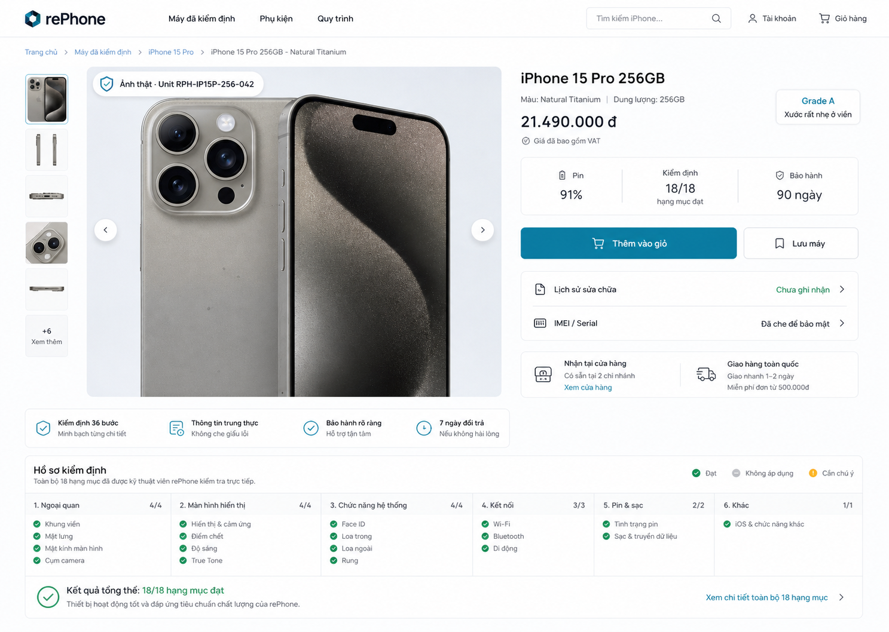

# rePhone Web Design System & UX Contract v1.0

> Trạng thái tài liệu: **APPROVED**  
> Phạm vi: **Post-P0 / P1 frontend refinement**  
> P0 baseline: [plan.md](plan.md)  
> Backend contract: [docs/readme.md](docs/readme.md)  
> Frontend implementation plan: [plan-fe.md](plan-fe.md)  
> Frontend baseline SHA: `801ad26`  
> Ngày cập nhật: `2026-08-25`



> Mockup trên chỉ khóa hierarchy, mật độ, màu sắc và cảm giác thị giác. Nó không phải nguồn cho dữ liệu, chính sách hoặc microcopy. Các claim minh họa như “36 bước”, “đã gồm VAT”, “2 chi nhánh”, “7 ngày đổi trả”, miễn phí giao hàng hoặc ETA không được đưa vào sản phẩm nếu chưa có contract/settings tương ứng.

## 1. Mục đích và cách sử dụng

`design.md` là nguồn quy ước cho cách giao diện rePhone được tổ chức, hiển thị và tương tác. Tài liệu dành cho developer, reviewer, người viết nội dung và người kiểm thử frontend.

Tài liệu này quyết định:

- Visual direction, design tokens và responsive behavior.
- Information hierarchy và navigation theo từng surface.
- Component contract, interaction state và accessibility behavior.
- Quy tắc nội dung, hình ảnh, icon và feedback.
- Tiêu chí để một page được xem là conformant với hệ thống thiết kế.

Tài liệu này không quyết định:

- Role hoặc quyền truy cập thực sự.
- Request/response DTO, endpoint, error code hoặc pagination contract.
- State transition, transaction, pricing, reservation hoặc inventory invariant.
- Chính sách bảo hành, hoàn tiền, giao nhận hoặc kiểm định.

Khi triển khai một page:

1. Đọc contract nghiệp vụ liên quan trong `docs`.
2. Đọc page pattern và component contract trong file này.
3. Đọc phase/work package tương ứng trong `plan-fe.md`.
4. Dùng generated API client; không tự tạo transport hoặc DTO song song.
5. Kiểm tra responsive, keyboard, loading, empty, error và conflict trước khi đánh dấu hoàn thành.

Một page conformant phải:

- Chỉ hiển thị claim có nguồn authority.
- Dùng token và component đã định nghĩa thay vì hard-code style mới.
- Hoạt động ở các viewport đã khóa.
- Không phá auth, ownership, guest credential hoặc security transport.
- Có đủ trạng thái ngoài happy path.
- Qua checklist Design QA tại §22.

## 2. Nguồn sự thật và precedence

Thứ tự ưu tiên khi có khác biệt:

1. `docs/requirements`, `docs/architecture`, `docs/data-model`, `docs/api` và `docs/quality` theo [source precedence](docs/readme.md#nguồn-sự-thật-khi-có-trùng-nội-dung).
2. OpenAPI và generated client phải khớp `docs`; nếu lệch, đó là blocker cần sửa đồng bộ.
3. `design.md` quyết định presentation/interaction khi contract không quy định.
4. `plan-fe.md` quyết định thứ tự, trạng thái và evidence triển khai.
5. CSS/component hiện hành là implementation; không tự trở thành contract chỉ vì đã tồn tại.
6. Mockup và website tham khảo chỉ là inspiration, không phải requirement.

### 2.1 Contract-source map

| Khu vực UI                          | Nguồn authority tối thiểu                                                                                     |
| ----------------------------------- | ------------------------------------------------------------------------------------------------------------- |
| Scope và non-goal                   | [Product vision](docs/requirements/product-vision-and-scope.md)                                               |
| Role, ownership và guest            | [Roles](docs/requirements/roles-and-permissions.md), [auth transport](docs/api/auth-token-transport.md)       |
| Auth và account                     | [Auth/account endpoints](docs/api/auth-and-account-endpoints.md)                                              |
| Catalog và exact unit               | [Public catalog endpoints](docs/api/public-catalog-endpoints.md)                                              |
| Cart và wishlist                    | [Cart/wishlist endpoints](docs/api/cart-and-wishlist-endpoints.md)                                            |
| Voucher                             | [Voucher endpoints](docs/api/voucher-endpoints.md)                                                            |
| Checkout và customer order          | [Checkout/order endpoints](docs/api/checkout-and-customer-order-endpoints.md)                                 |
| Payment proof                       | [Payment proof/review](docs/api/payment-proof-and-review-endpoints.md)                                        |
| Backoffice catalog/inventory        | [Backoffice catalog/inventory](docs/api/backoffice-catalog-inventory-endpoints.md)                            |
| Fulfillment và refund               | [Backoffice order/fulfillment/refund](docs/api/backoffice-order-fulfillment-refund-endpoints.md)              |
| Warranty và after-sales             | [Warranty/after-sales](docs/api/warranty-and-aftersales-endpoints.md)                                         |
| Employee, customer, settings, audit | [System endpoints](docs/api/employee-settings-audit-endpoints.md)                                             |
| Response và error handling          | [Response contract](docs/api/response-contract.md), [error catalog](docs/api/error-catalog.md)                |
| Typed transport                     | [OpenAPI/client](docs/api/openapi-and-client.md)                                                              |
| NFR và test                         | [NFR](docs/requirements/non-functional-requirements.md), [testing strategy](docs/quality/testing-strategy.md) |

## 3. Định vị trải nghiệm

Ba nguyên tắc trung tâm:

1. **Model giúp khám phá.** Product/model card giúp khách thu hẹp dòng máy, dung lượng, màu và mức giá.
2. **Exact unit giúp quyết định.** Khách mua một `InventoryUnit` cụ thể, không mua một cấu hình chung chung.
3. **Inspection giúp tin tưởng.** Ảnh thật, pin, ngoại hình, lịch sử sửa chữa đã biết và checklist là bằng chứng trước quyết định mua.

Giao diện phải tạo cảm giác:

- Minh bạch, chính xác và bình tĩnh.
- Có chuyên môn nhưng không lạnh lùng.
- Có đủ dữ kiện nhưng không giống dashboard kỹ thuật.
- Bằng chứng xuất hiện trước quảng cáo và cross-sell.
- Mỗi bước đều cho người dùng biết chuyện gì đang xảy ra và nên làm gì tiếp theo.

Không định vị rePhone như marketplace. Một sản phẩm không có seller card, seller rating hoặc chính sách khác nhau theo người bán.

## 4. Visual direction — Technical Editorial

Visual direction đã duyệt là **Direction 3 — Technical Editorial**.

Đặc trưng:

- Light mode duy nhất trong scope hiện tại.
- Nền trắng/xám xanh nhạt, chữ deep ink.
- Cyan/teal dùng tiết chế cho CTA, focus và dữ kiện quan trọng.
- Ảnh exact unit là visual chính của trang mua hàng.
- Border mảnh là phương thức phân cấp mặc định; shadow chỉ dùng khi thực sự nổi lớp.
- Typography có nhịp editorial, khoảng trắng rõ, số liệu dễ quét.
- Inspection dossier mang cảm giác hồ sơ đáng tin, không mang thẩm mỹ terminal hoặc sci-fi.

### 4.1 Storefront và customer portal

- Layout rộng nhưng có reading width rõ.
- Dữ kiện mua hàng được nhóm thành gallery, metrics, fulfillment, CTA và evidence.
- Card không bo tròn/shadow quá mức.
- Mỗi page có một primary action rõ ràng.
- Trang exact unit là reference page chuẩn cho toàn bộ storefront.

### 4.2 Backoffice

- Dùng cùng token, typography và status semantics với storefront.
- Mật độ cao hơn, ưu tiên scan, filter, queue, timeline và action.
- Desktop dùng sidebar + top bar + content fluid.
- Table/list không được biến thành hàng chục card trang trí.
- Detail page ưu tiên summary, status axes, timeline, evidence và authoritative action rail.
- Mobile vẫn phải hoàn tất được critical command, nhưng màn hình staff được tối ưu trước cho `>= 1024px`.

## 5. Content voice và microcopy

### 5.1 Giọng điệu

- Gọi khách hàng là **“bạn”**.
- Câu ngắn, tự nhiên, thân thiện nhưng không suồng sã.
- Dùng từ cụ thể: ảnh, pin, mã máy, tình trạng, phí, thời hạn.
- Nói thẳng giới hạn hoặc rủi ro thay vì che bằng copy marketing.
- Không dùng giọng quảng cáo khoa trương hoặc câu chữ dài, chung chung, lặp cấu trúc như nội dung do AI tạo hàng loạt.
- Backoffice dùng động từ nghiệp vụ chính xác, không dùng câu “thành công mỹ mãn” hoặc lời khen không cần thiết.

Ví dụ storefront:

```text
Biết rõ chiếc máy trước khi xuống tiền.
Ảnh thật, pin thật và 18 hạng mục kiểm định của đúng chiếc iPhone bạn sẽ nhận.
```

Ví dụ error:

```text
Chiếc máy này vừa không còn khả dụng.
Bạn có thể quay lại dòng iPhone 15 Pro để chọn chiếc khác.
```

Không dùng:

```text
Trải nghiệm giải pháp mua sắm tối ưu, toàn diện và đột phá.
Săn deal cực sốc ngay hôm nay!
```

### 5.2 Naming dictionary

| Khái niệm            | Label ưu tiên                              |
| -------------------- | ------------------------------------------ |
| Physical iPhone      | `Máy`, `Chiếc máy`, `Mã máy`               |
| Product/model        | `Dòng máy`, tên model                      |
| Inspection           | `Kiểm định`, `Hồ sơ kiểm định`             |
| Cosmetic grade       | `Grade A/B/C` kèm giải thích quan sát được |
| Battery health       | `Pin 91%` hoặc label theo contract         |
| Repair history       | `Lịch sử sửa chữa`                         |
| Masked identifiers   | `IMEI/Serial đã che`                       |
| Availability         | `Còn hàng`, `Không còn khả dụng`           |
| Backoffice operation | Dùng đúng named command của API            |

Không dịch role/status/entity trong code hoặc log UI nội bộ. Giữ `CUSTOMER`, `EMPLOYEE`, `ADMIN`, `AVAILABLE`, `InventoryUnit` trong backtick khi cần nói về contract.

### 5.3 CTA dictionary

- `Xem máy này`
- `Xem hồ sơ kiểm định`
- `Thêm vào giỏ`
- `Lưu máy`
- `Tiếp tục thanh toán`
- `Tính lại`
- `Xác nhận đặt hàng`
- `Nộp minh chứng`
- `Yêu cầu bảo hành hoặc hậu mãi`
- Backoffice dùng named action: `Bắt đầu chuẩn bị`, `Xác minh thanh toán`, `Bàn giao vận chuyển`.

### 5.4 Claim governance

- Không tạo fake urgency, sold count hoặc countdown.
- Không dùng giá gạch ngang nếu `compareAtPrice` hoặc nguồn giá không có authority rõ.
- Không hứa ETA, phí theo địa chỉ, carrier service hoặc phương thức thanh toán chưa được contract hỗ trợ.
- Không dùng review/rating, loyalty hoặc recommendation engine trong scope hiện tại.
- Không suy diễn số lượng tồn exact unit hoặc location nội bộ.
- Claim từ `StoreSettings` phải đọc runtime và có fallback an toàn.

## 6. Information architecture và role navigation

`GUEST` là access mode, không phải database role. Frontend chỉ ẩn/hiện navigation để hỗ trợ UX; backend vẫn là security authority.

### 6.1 GUEST

- Home, catalog, model, exact unit và store.
- Public voucher discovery.
- Cart và checkout guest.
- Order/warranty/after-sales detail chỉ qua credential hợp lệ.
- Không có wishlist hoặc order list.

### 6.2 CUSTOMER

- Tất cả public surface.
- Account, address và security.
- Wishlist, checkout, orders, warranty và after-sales list/detail.

### 6.3 EMPLOYEE

- Storefront vẫn đọc được như public user.
- Header có entry rõ sang backoffice.
- Backoffice operational surface theo permission contract.
- Không tải hoặc render cost/admin-only action.

### 6.4 ADMIN

- Toàn bộ employee operational surface.
- Employee/customer lifecycle, settings, audit, cost và admin-only actions.

### 6.5 Navigation shells

- `StorefrontHeader`: wordmark, Máy đã kiểm định, Phụ kiện, Quy trình, search, account, cart.
- `AuthShell`: tối giản, không kéo navigation thương mại vào one-time-token flow.
- `CustomerShell`: storefront header + account/post-purchase navigation.
- `BackofficeShell`: sidebar theo capability, top bar actor/session, main content và contextual breadcrumb.
- Mobile navigation dùng sheet có focus trap, Escape và focus return.

## 7. Design tokens

### 7.1 Color

| Token                    |                          Giá trị | Dùng cho                   |
| ------------------------ | -------------------------------: | -------------------------- |
| `--color-canvas`         |                        `#F7F9FB` | Nền toàn trang             |
| `--color-surface`        |                        `#FFFFFF` | Panel/card/form            |
| `--color-surface-subtle` |                        `#F1F5F8` | Nhóm dữ liệu nhẹ           |
| `--color-brand-soft`     |                        `#E2F5F9` | Highlight inspection/trust |
| `--color-ink`            |                        `#0C1728` | Heading                    |
| `--color-body`           |                        `#273548` | Body text                  |
| `--color-muted`          |                        `#667486` | Metadata/secondary text    |
| `--color-border`         |                        `#DCE4EA` | Divider/border             |
| `--color-border-strong`  |                        `#C7D2DC` | Active/structural border   |
| `--color-primary`        |                        `#007C9F` | Primary action/link        |
| `--color-primary-hover`  |                        `#006780` | Hover/pressed              |
| `--color-success`        |                        `#16875B` | Success/pass               |
| `--color-warning`        |                        `#A96508` | Warning/review             |
| `--color-danger`         |                        `#B4232D` | Error/destructive          |
| `--color-info`           |                        `#1769AA` | Informational state        |
| `--focus-ring`           | `0 0 0 3px rgb(0 124 159 / 22%)` | Keyboard focus             |

Không dùng màu đơn độc để truyền status. Luôn có text và/hoặc icon.

### 7.2 Typography

Font stack:

```css
Inter, ui-sans-serif, system-ui, -apple-system, BlinkMacSystemFont, "Segoe UI", sans-serif
```

| Style         | Size/line |  Weight | Ghi chú                              |
| ------------- | --------- | ------: | ------------------------------------ |
| Display       | `32/40`   |     700 | Hero ngắn                            |
| Page title    | `24/32`   |     700 | Một `h1` mỗi page                    |
| Section title | `20/28`   | 650–700 | `h2`                                 |
| Body          | `16/24`   |     400 | Nội dung chính                       |
| Body small    | `14/20`   | 400–600 | Metadata/action phụ                  |
| Label/meta    | `12/16`   |     600 | Tracking `0.02em`                    |
| Price         | `30/36`   |     700 | `font-variant-numeric: tabular-nums` |

Không dùng heading storefront cỡ cực lớn làm đẩy thông tin mua hàng xuống dưới fold.

### 7.3 Spacing, sizing và grid

Spacing scale:

```text
4, 8, 12, 16, 20, 24, 32, 40, 48, 64, 80
```

- Container storefront tối đa `1440px`.
- Page gutter: `16px` mobile, `24px` tablet, `40px` desktop.
- Grid gap: `16px` mobile, `24px` desktop.
- Control mặc định cao tối thiểu `44px`.
- Desktop layout dùng 12 cột; reading width không vượt khoảng `760px`.
- Backoffice dùng fluid content với max width theo page; table có min column strategy rõ.

### 7.4 Radius, border và elevation

| Token            | Giá trị |
| ---------------- | ------: |
| Small            |   `6px` |
| Control          |   `8px` |
| Card/panel/media |  `10px` |
| Pill             | `999px` |

- Base card: border, không shadow.
- Raised: `0 1px 2px rgb(12 23 40 / 6%)`.
- Hover: `0 8px 24px rgb(12 23 40 / 8%)`.
- Overlay: `0 20px 48px rgb(12 23 40 / 14%)`.

### 7.5 Motion

- Fast `120ms`, standard `180ms`, panel `240ms`.
- Easing `cubic-bezier(.2, 0, 0, 1)`.
- Hover nâng tối đa `translateY(-1px)`; ảnh zoom tối đa `1.01`.
- Không parallax, spring hoặc animation trang trí liên tục.
- `prefers-reduced-motion` tắt transform/animation không thiết yếu.

### 7.6 Layering

| Layer                  | Token gợi ý |
| ---------------------- | ----------: |
| Base                   |           0 |
| Sticky content         |          20 |
| Header                 |          30 |
| Mobile purchase bar    |          40 |
| Drawer/dialog backdrop |          80 |
| Drawer/dialog          |          90 |
| Toast                  |         100 |

Không tạo `z-index` tùy ý trong page module.

## 8. Responsive system

| Range       | Tên     | Nguyên tắc                                     |
| ----------- | ------- | ---------------------------------------------- |
| `<640px`    | Mobile  | Một cột, sticky purchase, drawer/filter sheet  |
| `640–959px` | Tablet  | 2–3 cột, summary không sticky nếu che nội dung |
| `>=960px`   | Desktop | Exact-unit 7/5, backoffice sidebar             |
| `>=1280px`  | Wide    | Product grid 4 cột, dense-data rộng hơn        |

Responsive không chỉ là thu nhỏ. Thứ tự nội dung phải thay đổi theo nhiệm vụ:

- Header mobile giữ wordmark, search và cart; phần còn lại vào sheet.
- Product grid chuyển 4/3/2/1 cột.
- Exact-unit dossier chuyển matrix thành accordion theo nhóm.
- Checkout summary chuyển từ sticky rail sang phần review trong flow.
- Backoffice table chuyển sang stacked row/detail disclosure khi không đủ chiều rộng; không buộc người dùng đọc bảng ngang ở 320px.
- Sticky element phải có safe-area và `scroll-padding` để không che focus/error.

## 9. Imagery và iconography

### 9.1 Phân loại ảnh

- **Exact-unit photo:** ảnh của chính máy vật lý đang bán.
- **Model/reference image:** dùng để khám phá dòng máy, không được ghi là ảnh máy thật.
- **Accessory image:** ảnh variant phụ kiện.
- **Editorial/support image:** minh họa quy trình hoặc thương hiệu, không thay bằng CSS art.

### 9.2 Exact-unit gallery

- Badge bắt buộc: `Ảnh thật · Mã máy {inventoryCode}`.
- Không trộn stock photo vào gallery exact unit.
- Ưu tiên các góc: trước, sau, hai cạnh, cổng/khe, camera và khuyết điểm đáng chú ý nếu có.
- Thumbnail có trạng thái chọn, keyboard navigation và accessible label.
- Gallery viewer có focus trap, Escape, nút trước/sau và focus return.
- Ảnh LCP dùng eager/priority behavior; ảnh còn lại lazy.
- Luôn khai báo width/height hoặc aspect ratio để tránh CLS.
- Ảnh lỗi trả fallback trung tính, không làm mất tên/giá/action.

### 9.3 Alt text

Mẫu:

```text
Mặt trước iPhone 15 Pro, mã máy RPH-..., màu Titan tự nhiên.
Cận cảnh vết xước nhẹ ở viền phải, mã máy RPH-...
```

Ảnh trang trí dùng alt rỗng. Không lặp cùng một alt cho mọi thumbnail.

### 9.4 Icon

- Dùng một bộ outline thống nhất, dự kiến `lucide-react`.
- Size mặc định `16`, `20`, `24`; stroke nhất quán.
- Icon nghiệp vụ quan trọng đi cùng text.
- Icon-only button bắt buộc có accessible name.
- Không emoji, text symbol, handcrafted inline SVG hoặc icon trộn nhiều phong cách.

## 10. Component contract

Mỗi shared component phải document tối thiểu:

```text
Purpose
Anatomy
Variants
States
Responsive behavior
Accessibility behavior
Do / Don't
```

Chỉ promote thành shared component khi dùng từ hai pattern trở lên hoặc bản thân có state/accessibility phức tạp.

### 10.1 Primitives

- `Button`: primary, secondary, ghost, destructive, icon; loading không đổi width đột ngột.
- `IconButton`: 44×44px, tooltip không phải nguồn label duy nhất.
- `Link`: phân biệt inline, navigation và standalone action.
- `Input`, `Textarea`, `Select`, `Checkbox`, `RadioCard`.
- `Field`: label, hint, control, field error.
- `Price`: VND, tabular numerals, không dùng floating point.
- `Badge` và `StatusChip`: icon/text/color mapping nhất quán.
- `Divider`, `Skeleton`, `InlineAlert`, `ErrorSummary`.

### 10.2 Navigation

- `StorefrontHeader`, `MobileNavSheet`, `BackofficeSidebar`, `TopBar`.
- `SearchField`, `Breadcrumbs`, `Pagination`, `Tabs`.
- `HeaderSessionActions` và `CartBadge` là client islands.

### 10.3 Product discovery và exact unit

- `ProductCard`: card cấp model, giá “Từ…”, không hiển thị fact exact-unit chưa có.
- `ExactUnitCard`: ảnh thật, mã máy, grade, pin, giá, warranty, availability.
- `FilterBar`/`FilterDrawer`, `SortControl`, empty search.
- `ActualUnitGallery`, `ActualUnitBadge`, `GradeBadge`, `GradeExplainer`.
- `MetricRail`: pin, kiểm định, bảo hành.
- `InspectionDossier`, `ChecklistGroup`, `ChecklistItem`.
- `RepairDisclosure`, `MaskedIdentifierDisclosure`, `TrustStrip`.
- `PurchaseSummary`, `FulfillmentPanel`, `StickyMobilePurchaseBar`.

### 10.4 Commerce và customer service

- `CartItemExactUnit`, `AccessoryCartItem`, `CartSummary`.
- `VoucherCard`, `CheckoutSection`, `OrderSummary`.
- `OrderTimeline`, `PaymentPanel`, `ShipmentTracking`.
- `RefundTimeline`, `WarrantyCard`, `AfterSalesCard`, `AttachmentUploader`.
- `AvailableActionPanel` chỉ render action backend cho phép.

### 10.5 Backoffice

- `OperationalQueue`, `DataTable`, `FilterBar`, `SavedQuerySummary`.
- `DetailHeader`, `StatusAxes`, `Timeline`, `AuditMetadata`.
- `ActionRail`, `CommandForm`, `ReasonField`, `ConfirmationDialog`.
- `EvidenceViewerLauncher`, `MediaManager`, `InspectionEditor`.
- `MoneyInput` giữ chuỗi chữ số; `IdentifierReveal` giữ dữ liệu raw trong memory ngắn nhất có thể.
- `Pagination` luôn server-authoritative với allowlisted filter/sort.

## 11. State và feedback semantics

Mọi page phải thiết kế các trạng thái sau nếu có thể xảy ra:

| State               | Cách trình bày                                                          |
| ------------------- | ----------------------------------------------------------------------- |
| Loading             | Skeleton giữ kích thước; không spinner toàn trang nếu chỉ một panel tải |
| Empty               | Giải thích vì sao trống và hành động tiếp theo                          |
| Unavailable/sold    | Nêu rõ máy không còn khả dụng và link về model                          |
| Stale price/cart    | Hiển thị giá cũ/mới và yêu cầu xem lại                                  |
| Conflict `409`      | Focus alert, refetch authoritative projection, không auto-submit        |
| Validation `422`    | Error summary + field error; giữ input an toàn                          |
| Unauthorized `401`  | Thử refresh theo transport hiện hành rồi đưa về login khi cần           |
| Forbidden `403`     | Không giả thành lỗi hệ thống; hiển thị thiếu quyền phù hợp surface      |
| Ownership not found | Dùng not-found copy, không tiết lộ resource tồn tại                     |
| Rate limit `429`    | Dùng `Retry-After`, disable/re-enable có kiểm soát                      |
| Provider `503`      | Giữ nghiệp vụ đã commit; cho retry đúng action an toàn                  |
| Replay              | Trả projection hiện hành, không hiện success side effect lặp            |

Frontend không tự suy diễn state machine, payment summary, available action, cost hoặc inventory counter.

## 12. Page patterns — storefront

### 12.1 Home

Thứ tự:

1. Value proposition: `Biết rõ chiếc máy trước khi xuống tiền.`
2. CTA vào catalog và quy trình kiểm định.
3. Một nhóm iPhone đang bán từ public query.
4. Trust proof: ảnh thật, pin, inspection, warranty.
5. Store/pickup summary nếu endpoint khả dụng.

Không gọi product sort theo createdAt là “máy mới về” nếu contract không chứng minh unit chronology.

### 12.2 Catalog/search

- Product card là model-level.
- Filter global chỉ dùng field public catalog hỗ trợ.
- Query nằm trong URL để back/forward/share hoạt động.
- Không client-filter một page đã pagination rồi gọi đó là full catalog filter.
- Mobile filter dùng drawer; active filter có summary và clear action.

### 12.3 Model detail

- Model facts tách khỏi danh sách máy vật lý.
- `availableUnits` có thể filter/sort local theo dữ liệu response hiện có.
- Mỗi exact-unit row/card có CTA `Xem máy này`.
- Không N+1 gọi unit detail để bù field thiếu trong list.

### 12.4 Exact-unit detail — canonical

Desktop:

```text
Breadcrumb
┌─────────────────────────────┬─────────────────────┐
│ Actual-unit gallery 7/12    │ Purchase rail 5/12  │
└─────────────────────────────┴─────────────────────┘
Trust/fulfillment strip
Inspection dossier full width
Condition / repair / identifier / warranty
```

Mobile order:

1. Context/back link.
2. Tên, cấu hình và grade.
3. Gallery 1:1 + horizontal thumbnails.
4. Giá và metric rail.
5. Fulfillment/trust.
6. Repair và masked identifier disclosure.
7. Inspection accordion.
8. Related available units nếu có contract.

Sticky purchase bar chỉ xuất hiện sau khi CTA gốc rời viewport và không che focus/content.

### 12.5 Store

- Dùng duy nhất public-safe store projection.
- Hiển thị tên, phone, address và pickup information.
- Thiếu store trả service-unavailable state; không tự chọn location nội bộ khác.

## 13. Page patterns — auth, account và commerce

### 13.1 Auth

- Form width vừa đọc, một mục tiêu mỗi page.
- Login/register/forgot-password không phô backoffice navigation.
- Reset/invitation token đi fragment → memory → fragment được xóa trước request.
- Không query, SSR HTML hoặc localStorage token.

### 13.2 Account

- `/account`: profile và session-safe summary.
- `/account/addresses`: list/create/edit/archive, ownership theo backend.
- `/account/security`: change-password form, không hiển thị password strength claim không có policy.

### 13.3 Cart

- Exact-unit identity luôn giữ ảnh, tên và inventory code.
- Blocking warning chặn tiếp tục; price changed yêu cầu xem lại nhưng không tự sửa snapshot.
- Cart không reserve hàng; copy không được hứa “đã giữ máy”.
- Sold item có CTA về model, không gợi ý unit giả.

### 13.4 Checkout

- Hai cột desktop: form và authoritative review.
- Preview không reserve; mọi thay đổi làm preview cũ mất hiệu lực.
- `CHECKOUT_REVIEW_REQUIRED` thay summary và yêu cầu xác nhận lại.
- Không tự retry create hoặc gửi lại payment/order mutation.
- Không render payment selector, fee calculator hoặc ETA giả.

## 14. Page patterns — customer post-purchase

- Order detail lấy timeline làm trục chính.
- Payment/proof, pickup/shipping, refund và warranty là các panel theo snapshot.
- Guest token chỉ dùng đúng transport contract.
- Signed URL mở tab mới với `noopener noreferrer`, không được persist.
- `availableActions` là authority cho cancel/upload/after-sales action.
- Attachment upload có file constraints, progress, retry-safe feedback và private semantics.
- Warranty/after-sales detail luôn nói rõ bước hiện tại và bước tiếp theo.

## 15. Page patterns — backoffice catalog và inventory

### 15.1 Catalog/variant/media

- Product list → create → detail.
- Product detail chứa variant management vì backend không có standalone variant detail GET.
- Media manager parameter hóa owner type; không giả một delete rule dùng cho mọi owner.
- Publish/activate/archive là named action có confirmation và error projection.

### 15.2 Inventory

- Inventory queue có filter/pagination và link intake.
- Unit detail tách safe overview, inspection history, lifecycle, media, identifier và admin-only cost.
- Cost chỉ request sau khi role gate xác nhận `ADMIN`; clear khi session/role đổi.
- Identifier lookup/reveal yêu cầu reason; raw value không vào URL, cache, log hoặc persisted state.
- Không generic status dropdown. Mỗi lifecycle dùng named command.

### 15.3 Inspection

- Editor giữ đúng bộ 18 check từ contract.
- Keyboard navigation, note conditional và completion summary rõ.
- Completed inspection read-only.
- Conflict tải lại projection thay vì merge mù.

### 15.4 Stock

- Stock level và movement là read-only projections.
- Receive/transfer/adjust/return là command form riêng.
- Không edit counter hoặc movement trực tiếp.
- Sau command, refetch level + movement ledger.

## 16. Page patterns — operational backoffice

- Queue page: filters, sort, pagination, deadline/overdue và primary status.
- Detail page: entity summary, three-axis status nếu có, timeline, finance/evidence và action rail.
- Command form không nhận amount/status/timestamp nếu backend tự tính.
- Destructive/terminal action hiển thị entity, trạng thái hiện tại, ảnh hưởng và reason field.
- `409` luôn reload authoritative detail.
- Replay không tạo toast/email/audit giả lần hai.
- Evidence viewer không đưa signed URL/path vào audit UI hoặc log.

Áp dụng cho payment, order, pickup/shipping, refund, warranty và after-sales.

## 17. Page patterns — system administration

- Employee/customer list dùng server pagination và safe projection.
- Detail/lifecycle action theo role; frontend hide không thay thế backend guard.
- Settings form dùng version hiện hành; conflict phải refetch, không auto-merge.
- Bank QR upload giữ object lifecycle theo backend; UI không xóa object cũ.
- Audit list không full-text JSON; detail redacted theo serializer.
- Health page chỉ hiển thị live/ready status và timestamp an toàn, không lộ config/environment.

## 18. Accessibility standard

Target: **WCAG 2.2 AA**.

- Text thường contrast tối thiểu `4.5:1`; component/focus `3:1`.
- Touch target tối thiểu `44×44px`.
- Một `h1`; heading không nhảy cấp vô lý.
- Dùng landmark `header`, `nav`, `main`, `aside`, `footer` đúng nghĩa.
- Mọi form control có label thật; placeholder không thay label.
- Error summary nhận focus và link tới field lỗi.
- Success/error async dùng live region phù hợp.
- Status không truyền bằng màu đơn độc.
- Drawer/dialog trap focus, Escape và focus return.
- Tooltip không hover-only.
- Gallery, accordion, tabs và pagination dùng được bằng keyboard.
- Kiểm tra ở `320px`, zoom `200%`, reduced motion và high contrast.
- `<html lang="vi">` và nội dung/accessible name bằng tiếng Việt tự nhiên.

## 19. Performance và technical constraints

- Next.js Server Component mặc định cho đọc dữ liệu/public catalog.
- Chỉ interaction thực sự cần state/browser API mới là Client Component.
- Không chuyển page SSR thành client page chỉ để dùng một button/gallery.
- Dùng generated client, không fetch rải rác.
- Query list phải pagination/batch, không N+1.
- Public image có kích thước/aspect ratio; LCP image eager, còn lại lazy.
- Loading skeleton không gây layout shift.
- `lucide-react` import theo icon, không bundle toàn library.
- Không thêm UI framework, Redux hoặc Storybook trong FE-0.
- CSS custom properties + CSS Modules coexist với legacy CSS; không rewrite toàn bộ `globals.css` một lần.

Representative mobile targets:

- LCP `<= 2.5s`.
- CLS `<= 0.1`.
- INP `<= 200ms`.

Đây là frontend quality budget trên seeded/test environment, không phải production SLA.

## 20. Security presentation

- Bearer access token giữ theo transport hiện hành; không localStorage.
- Refresh token/cookie không đọc bằng page code.
- Guest order/one-time auth token không vào query, analytics, log hoặc SSR HTML.
- Raw identifier chỉ tồn tại trong UI memory khi reveal thành công, có `no-store`, clear khi đóng/blur/session change.
- Cost chỉ tải và render cho `ADMIN`.
- Private bucket/path, evidence digest và signed URL không xuất hiện trong public DTO/UI log.
- Signed URL không cache; hết hạn thì yêu cầu URL mới.
- Contact/address/bank data không được đưa vào client telemetry hoặc generic error dump.
- Không truyền private data qua DOM data attribute.
- UI không thay thế role/ownership guard của backend.

## 21. Anti-patterns

- Ảnh model không ghi nhãn hoặc bị gọi là ảnh exact unit.
- Grade không có mô tả quan sát được.
- Grade bị dùng để ngụ ý máy có lỗi chức năng.
- Fake urgency, discount, sold count hoặc review.
- CTA cạnh tranh nhau cùng cấp.
- Cyan xuất hiện ở mọi card/status.
- Card bo tròn/shadow quá mức.
- Icon trộn style hoặc emoji.
- Horizontal table là cách duy nhất để dùng backoffice trên mobile.
- Hover-only interaction.
- Frontend tự tính state, available action, money hoặc counter authoritative.
- N+1 unit detail từ catalog/cart.
- Auto-submit lại sau `409`.
- Generic status dropdown cho lifecycle domain.
- Raw identifier/cost/private path trong log hoặc URL.
- SEO copy chen trước dữ kiện mua hàng.

## 22. Design QA checklist

### Visual

- [ ] Hierarchy đúng Direction 3.
- [ ] Token được dùng, không có màu/radius/spacing tùy ý.
- [ ] Exact-unit photo và model image được phân biệt rõ.
- [ ] Không có claim vượt contract.
- [ ] Primary action rõ; secondary action không tranh cấp.

### Responsive

- [ ] 320, 390, 768, 1024 và 1440px không overflow.
- [ ] Sticky element không che content/focus.
- [ ] Matrix/table có mobile representation phù hợp.
- [ ] Safe-area được xử lý cho mobile bottom action.

### Interaction và accessibility

- [ ] Keyboard-only hoàn tất được core task.
- [ ] Focus visible và focus return đúng.
- [ ] Label, heading, landmark, live region đúng.
- [ ] Status không phụ thuộc màu.
- [ ] Zoom 200% và reduced motion dùng được.

### Data và failure

- [ ] Loading, empty, unavailable, conflict và provider error có thiết kế.
- [ ] `401/403/404/409/422/429/503` không bị gom thành “Lỗi hệ thống”.
- [ ] Mutation refetch authoritative projection khi cần.
- [ ] Không rò token, identifier, cost, private path hoặc signed URL.

### Quality

- [ ] Component/unit tests xanh.
- [ ] Browser happy path và failure path xanh.
- [ ] Axe không có serious/critical violation.
- [ ] Visual snapshot được review ở desktop/mobile.
- [ ] Performance budget đạt hoặc có debt entry rõ.

## 23. Governance, deprecation và maintenance

### 23.1 Ownership

- Frontend/design owner duyệt thay đổi visual/component contract.
- Backend/docs owner duyệt claim nghiệp vụ hoặc thay đổi behavior.
- Security-sensitive component cần review transport/redaction.

### 23.2 Change workflow

Thay token/component phải cập nhật trong cùng concern:

- `design.md` nếu contract thay đổi.
- Executable token/component.
- Affected tests và snapshots.
- `plan-fe.md` nếu phase/status/debt thay đổi.

### 23.3 Component promotion

- Shared khi dùng ít nhất hai pattern hoặc có state/accessibility phức tạp.
- Không tạo generic `Card`/`Section` chỉ để giảm vài dòng markup.
- Domain component được ưu tiên nếu nó khóa đúng semantics.

### 23.4 Deprecation

- Đánh dấu `DEPRECATED` trong docs/code comment phù hợp.
- Ghi replacement và phase xóa trong `plan-fe.md`.
- Giữ compatibility wrapper đến khi route cuối đã migrate và regression xanh.
- Không silent breaking change.

### 23.5 Design debt

Mỗi debt entry có:

```text
Route/component
Current behavior
Target pattern
Impact
Owner phase
Status
```

Không dùng design debt để hợp thức hóa security hoặc contract violation.

## 24. Decision log

| Ngày       | Quyết định                                     | Phương án đã loại                                | Lý do                                               |
| ---------- | ---------------------------------------------- | ------------------------------------------------ | --------------------------------------------------- |
| 2026-08-25 | Technical Editorial direction số 3             | Premium tối giản; retail Việt Nam đậm khuyến mãi | Làm rõ lợi thế exact-unit inspection và vẫn gần gũi |
| 2026-08-25 | Copy gọi khách là “bạn”                        | `anh/chị`; không xưng hô                         | Tự nhiên, hiện đại, ít cảm giác máy móc             |
| 2026-08-25 | Wordmark chữ `rePhone`                         | Thiết kế logo mới trong phase đầu                | Tập trung nguồn lực vào UX mua hàng                 |
| 2026-08-25 | CSS variables + CSS Modules                    | Tailwind/Radix; tiếp tục global CSS              | Migrate dần, ít dependency, hợp một web app         |
| 2026-08-25 | Giữ nguyên backend trong redesign              | Mở rộng unit discovery API ngay                  | Hạn chế regression và dùng contract P0 đã ổn định   |
| 2026-08-25 | Full 160-operation frontend coverage           | Chỉ redesign 37 route hiện có                    | Loại bỏ các nghiệp vụ còn phụ thuộc Swagger         |
| 2026-08-25 | Exact-unit là canonical page                   | Home hoặc generic product card làm chuẩn         | Đây là khác biệt sản phẩm mạnh nhất                 |
| 2026-08-25 | Storefront và backoffice dùng hai density mode | Một layout/card language cho mọi surface         | Nhiệm vụ mua hàng và vận hành có mật độ khác nhau   |
| 2026-08-25 | Không dark mode/complex animation ở P1         | Làm đầy đủ theme/motion system                   | Không phục vụ critical journey hiện tại             |

Decision log này chỉ ghi quyết định presentation/interaction. Không sửa hoặc thay thế ADR nghiệp vụ.

## 25. Visual references — non-authoritative

- [Apple Certified Refurbished](https://www.apple.com/shop/refurbished/iphone): hierarchy tiết chế và quality story.
- [Back Market iPhone](https://www.backmarket.com/en-us/p/iphone-15): trust/condition gần CTA.
- [Back Market grading](https://help.backmarket.com/hc/en-us/articles/360026656634-What-condition-will-my-device-be-in): mô tả grade quan sát được.
- [Reebelo iPhone 15](https://reebelo.com/collections/apple-iphone-15): condition, battery, warranty và fulfillment hierarchy.
- [Swappa exact listing](https://swappa.com/listing/view/LZMZ35739): tư duy chọn đúng physical listing.
- [CellphoneS used iPhone](https://cellphones.com.vn/iphone-15-pro-max-256gb-cu-dep.html): sequence giá–variant–giao nhận trong bối cảnh Việt Nam.
- [FPT Shop product](https://fptshop.com.vn/dien-thoai/iphone-17-pro-max): retail purchase hierarchy và fulfillment cues.

Không sao chép logo, asset, content hoặc layout nguyên bản từ các nguồn trên.

## 26. Changelog

| Version | Ngày       | Thay đổi                                                                                          |
| ------- | ---------- | ------------------------------------------------------------------------------------------------- |
| `1.0`   | 2026-08-25 | Khóa Technical Editorial, full web scope, tokens, patterns, accessibility, security và governance |
